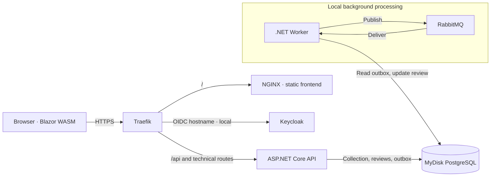

# MyDisk

MyDisk is a portfolio project for managing a private record collection. Members can add and edit records, associate artists, and submit reviews. The API accepts reviews for asynchronous moderation. Administrators can inspect and archive reviews across collections. The project explores .NET application design, reliable background processing, and Kubernetes deployment.

- [Applications and goals](#applications-and-goals)
- [Architecture](#architecture)
- [Documentation and diagrams](#documentation-and-diagrams)
- [Getting started](#getting-started)
- [Tests and verification](#tests-and-verification)
- [Kubernetes experiments](#kubernetes-experiments)
- [Infrastructure and delivery](#infrastructure-and-delivery)
- [Open work](#open-work)

## Applications and goals

| Component | Role in MyDisk | What the project explores |
| --- | --- | --- |
| [ASP.NET Core API](apps/api/) | Exposes the collection, reviews, and diagnostics over HTTP, with Swagger for exploring the endpoints. | Layered backend design, domain modeling, separation of commands and queries, testing at each layer, and retry policies with Polly. |
| [Blazor WebAssembly frontend](apps/frontend/) | Provides the collection views, forms, diagnostics, and user profile. | Calling a REST API from a browser-based .NET application, building the interface with MudBlazor, and managing loading, error, and session states. |
| [.NET Worker](apps/api/src/Worker/) | Publishes queued events and moderates submitted reviews in the background. | Separating HTTP requests from background jobs, storing events in a transactional outbox, and handling retries and redelivery. |
| [RabbitMQ](apps/messaging/) | Routes review events to the worker and holds failed deliveries in a dead-letter queue. The local overlay deploys the broker. | Durable message delivery and acknowledgments. |
| [Keycloak](apps/keycloak/) | Provides the `mydisk` realm, the public `mydisk-frontend` client, and the French sign-in theme for k3d. | Delegating sign-in to an identity provider, using the OpenID Connect authorization code flow with PKCE, and validating access tokens issued for `mydisk-api`. |
| [Grafana](apps/grafana/) | Runs locally with a preconfigured Prometheus data source. | Preparing to visualize application metrics under load. The [Prometheus module](platform/prometheus/) and dashboards are still to be integrated. |
| [PostgreSQL and EF Core migrations](apps/api/src/Data.Migrations/) | Stores collections, reviews, and the outbox. A migration bundle initializes and updates the schema. Keycloak uses a separate PostgreSQL instance. | Running migrations independently of API startup, persisting data across restarts, and separating application and migration privileges on Kubernetes. |

## Architecture



The browser loads Blazor from NGINX. Traefik routes `/api`, `/health`, `/maintenance`, and `/swagger` directly to the API on the same origin. The frontend includes the access token when calling protected endpoints. The API validates the token signature, expiration, issuer, and `mydisk-api` audience. On k3d, a CoreDNS rule lets the API pod resolve the same issuer hostname that the browser uses. The pod trusts the local mkcert certificate authority for OIDC discovery. [Traefik routing](deploy/k8s/routing/) · [HTTPS and Keycloak discovery](infra/HTTPS.md#local-k3d-https)

### API and domain

The API and frontend target **.NET 11**. The backend solution is [`apps/api/mydisk-api.sln`](apps/api/mydisk-api.sln), and the API layers are under [`apps/api/src`](apps/api/src/).

| Layer | Responsibility |
| --- | --- |
| `Api` | REST controllers, Swagger, JWT authentication, health probes, and dependency wiring. |
| `Contracts` and `Contracts.Validators` | Input and output contracts and FluentValidation rules. |
| `Services` | Use cases expressed as MediatR commands and queries, AutoMapper mappings, validation and transaction behaviors, and review moderation rules. |
| `Domain` | Collection entities and aggregates, value objects, domain events, and repository interfaces. Business rules are independent of HTTP and EF Core. |
| `Data` and `Data.Configurations` | Repository, unit-of-work and outbox implementations, EF Core mappings, and PostgreSQL access through Npgsql. |
| `Data.Migrations` | Migration history and bundle configuration. |
| `Worker` and `Messaging` | Background host, outbox publication, and RabbitMQ consumption. |

Creating a record starts in a controller and goes through a command handler. The handler constructs the entity with the `Name` value object. The EF Core repository saves the record, and the `Services` layer handles its creation event. [Controller](apps/api/src/Api/Controllers/DiskController.Post.cs) · [Command handler](apps/api/src/Services/Disks/CreateDiskCommandHandler.cs) · [EF Core repository](apps/api/src/Data/DiskRepository.cs)

### Frontend

`App.razor` configures routing and the Blazor providers. `Layout` contains navigation and the MudBlazor theme, `Pages` and `Components` make up the screens, and `Services` coordinates API access. `CollectionWorkspace` groups collection operations. The application's root directory contains its `Dockerfile`, NGINX configuration, and Kubernetes manifests. [Frontend source](apps/frontend/src/)

Record details are looked up by exact name. The interface flags ambiguous results when multiple records share a name. You can associate a known artist or enter a UUID. After submission, the frontend polls for the review status and displays the moderation result. Sign-in settings depend on the environment. [OpenID Connect configuration](#openid-connect-configuration)

When a signed-in user creates a disk, the API records the issuer and subject from their validated access token. Existing records and local demo records can have an unknown creator.

### Worker and review lifecycle

`POST /api/Review` saves the new review as `Pending` and records its event in the PostgreSQL outbox in the same transaction. It returns HTTP `202 Accepted` and a location where the frontend can read the status. In the worker process, `RabbitMqOutboxPublisher` sends the event to RabbitMQ and `ReviewCreatedConsumer` dispatches the moderation command. The keyword moderator produces a `Published` or `Rejected` decision. A member or an administrator can also archive a review within their permissions. [Worker, outbox, and retry sequences](docs/WORKER.md)

### Platform and environments

| Environment | Components and use |
| --- | --- |
| [Local k3d](deploy/k8s/local/) | Runs the full stack with the worker, RabbitMQ, Keycloak and Grafana. k3d runs k3s in Docker, Kustomize assembles the local overlays, and Traefik serves HTTPS with mkcert certificates. |
| [AKS](deploy/k8s/cloud/) | Runs the API, frontend, migrations, and PostgreSQL. To enable sign-in, provide a reachable OIDC issuer and configure the API and frontend. The worker and RabbitMQ are local-only in the current manifests, so any reviews submitted on AKS stay `Pending`. |

On Kubernetes, PostgreSQL runs in a `StatefulSet` with a persistent volume. A `ConfigMap` holds public settings and a `Secret` holds passwords. The API and worker share the application role, and the migration job uses a separate role. A `NetworkPolicy` allows the API, worker and migration pods to connect to PostgreSQL. PostgreSQL creates the roles when it initializes an empty data volume. [API manifests](apps/api/k8s/base/)

Migrations ship in a dedicated image. Application deployment waits for the `mydisk-api-migrations` Job to succeed before deploying the API, frontend, and local worker. The bundle applies pending migrations. The local k3d overlay sets `SEED_DATA=true` to add demo data to empty tables.

The Dockerfiles separate build and runtime stages. The API Dockerfile produces separate images for the ASP.NET Core server, the EF Core bundle, and the worker. The frontend Dockerfile publishes static files to an NGINX image. These images run as a non-root user. [Backend Dockerfile](apps/api/Dockerfile) · [Frontend Dockerfile](apps/frontend/Dockerfile)

## Documentation and diagrams

| Guide | Diagrams and details |
| --- | --- |
| [Architecture](docs/ARCHITECTURE.md) | System context, components, .NET project dependencies, local and AKS deployments, CI/CD, and migration sequence. |
| [Use cases and HTTP sequences](docs/CAS-UTILISATION.md) | Actors and permissions, sign-in, collection operations, review submission and archiving, administration, and health checks. |
| [Class guide and data model](docs/CLASSES.md) | Responsibilities of the main classes, class relationships, and the PostgreSQL schema. |
| [Worker and outbox](docs/WORKER.md) | Review and outbox states, publication and consumption sequences, retry behavior, and local operation. |

The guides are written in French. Their Mermaid diagrams render directly in GitHub.

## Getting started

Run `make` commands from the repository root. `make help` lists the targets and their options.

### k3d with sign-in

This setup requires Docker, `make`, `openssl`, `k3d`, `kubectl`, and `mkcert`.

```bash
mkcert -install
make dev-up
make k8s-status
```

`make dev-up` creates or starts the cluster, checks node health, builds and imports the images, initializes local secrets and certificates, and deploys the applications. It waits for the application, Grafana, Keycloak and RabbitMQ rollouts and runs HTTP smoke checks. If a node reports `DiskPressure`, use `docker system df` to check disk usage before retrying deployment.

| Service | Local address |
| --- | --- |
| Frontend | `https://localhost:8443/` |
| Swagger | `https://localhost:8443/swagger/index.html` |
| Keycloak admin console | `https://auth.mydisk.localhost:8443/admin` |
| Grafana | `http://grafana.localhost:8080/` |

Deployment generates the Keycloak admin credentials in `apps/keycloak/k8s/overlays/local/keycloak.env`, which Git ignores. In the Keycloak console, create a user in the `mydisk` realm and set a password to sign in to MyDisk. A fresh installation imports the realm, its client, and the audience mapper. For an existing realm, use **Realm settings → Action → Partial import** to update the client. If you update it manually, configure the mapper to add the `mydisk-api` audience to the access token. Set the `mydisk` theme and the default language under **Themes** and **Localization**. [Realm configuration](apps/keycloak/k8s/overlays/local/mydisk-realm.json)

`make cluster-stop` stops the cluster between sessions. `make dev-down` removes the overlay resources and then stops the cluster. `make local-https` updates local HTTPS on an existing cluster without rebuilding the images or rerunning migrations. [HTTPS setup](infra/HTTPS.md#local-k3d-https)

### Development from the IDE

With the .NET 11 SDK installed, open `apps/api/mydisk-api.sln`. Start the local k3d stack with `make dev-up` to run Keycloak and prepare PostgreSQL. Run `make k8s-forward-db` from the repository root and leave it running while you debug the API.

From the repository root, start the API with the application database role. The following command reads the generated password from the local overlay and passes it to the API through its environment.

```bash
(
  pg_app_password=$(sed -n 's/^POSTGRES_APP_PASSWORD=//p' apps/api/k8s/overlays/local/secrets.env)
  ASPNETCORE_ENVIRONMENT=Development Https__TerminatedAtProxy=true \
    ConnectionStrings__DefaultConnection="Host=127.0.0.1;Port=5432;Database=mydisk;Username=mydisk_api;Password=${pg_app_password};GSS Encryption Mode=Disable" \
    dotnet run --project apps/api/src/Api --no-launch-profile --urls http://localhost:5059
)
```

From the repository root in a second terminal, run `make frontend-restore` and then `make frontend-dev`. The frontend runs at `http://localhost:5100` and calls the API at `http://localhost:5059`. Sign-in with the supplied development settings requires access to the local Keycloak HTTPS endpoint.

### OpenID Connect configuration

For a different provider or environment, set `Authentication:Authority` and `Authentication:ClientId` in the frontend's public configuration. In the API, set `Authentication__Authority` and, if needed, `Authentication__Audience`, which defaults to `mydisk-api`. The OIDC client must allow the frontend origin and the full callback URLs for `/authentication/login-callback` and `/authentication/logout-callback`. [Frontend configuration](apps/frontend/src/wwwroot/)

### Review moderation

To verify the local worker, sign in, create a disk with a past release date, and submit a review from the disk’s detail page. The review appears as **En cours de modération** and should become **Publié** after the worker processes it. A separate review containing the configured test phrase `kazoo goblin` should become **Refusé**. Run `make k8s-logs-worker` to follow the processing. [Moderation rules](apps/api/src/Services/Reviews/Moderation/KeywordReviewModerator.cs)

To give a test account access to review administration, configure the Keycloak client role:

1. In the `mydisk` realm, open **Clients → mydisk-frontend → Roles**. A new realm already has the client role `admin`. For an existing realm, create it there.
2. In the same client's dedicated scope, add a **User Client Role** mapper for `mydisk-frontend` if `mydisk-roles` is missing. Set the claim name to `mydisk_roles`, the JSON type to `String`, enable **Multivalued**, and add it to the access token, ID token, and userinfo. See the [realm configuration](apps/keycloak/k8s/overlays/local/mydisk-realm.json) for the exact mapper keys.
3. Under **Users → Role mapping**, assign the `mydisk-frontend` client role `admin` to a test account. Sign out and sign in again so MyDisk receives tokens with the new role.
4. Open **Administration → Avis** in MyDisk. The admin can view and archive reviews across collections. **Ma collection** shows the signed-in account’s disks. Older records with no recorded creator stay outside personal collections.

## Tests and verification

### Automated suites

| Suite | Coverage | How to run |
| --- | --- | --- |
| xUnit unit tests | Domain rules for disks and reviews, contract validation, MediatR handlers, domain events and pipeline behaviors, controllers and filters, a disk repository with simulated persistence, random number generation, and Polly retry behavior. | `make test-unit` runs the seven `*.Tests` projects and writes TRX reports to `TestResults/`. |
| HTTP integration | `WebApplicationFactory` runs the ASP.NET Core pipeline with mock repositories and test authentication. Tests cover disk operations, `401` responses to unauthenticated requests on protected routes, and public access to the liveness and maintenance endpoints. | `dotnet test apps/api/src/Api.IntegrationTests/Api.IntegrationTests.csproj` |
| PostgreSQL integration | Repository tests exercise disk and artist persistence. Service tests include creating and reading disks through EF Core. | `(cd apps/api && dotnet test mydisk-api.sln)` runs the entire solution. Both PostgreSQL suites require a test database with migrations already applied. Configure the connections in [`xunit.json`](apps/api/src/Data.IntegrationTests/xunit.json) and [`appsettings.json`](apps/api/src/Services.IntegrationTests/appsettings.json). |
| Blazor build | Restores dependencies and builds the components, C# code, and WebAssembly assets in Release mode. | `make frontend-restore frontend-check` |
| OpenTofu validation | Checks HCL formatting and validates the Azure bootstrap, AKS, Kubernetes platform, and standalone frontend stacks. | `make infra-check` |

### Checks against a running deployment

| Check | What it verifies |
| --- | --- |
| `make k8s-smoke` | Through the HTTPS ingress, the page HTML contains the Blazor startup script, `/health/ready` returns `Healthy`, and `/api/Disk/disks` returns `401` without a token. |
| `make k8s-smoke-keycloak` | The local TLS certificate is trusted, the `master` realm discovery document reports the expected issuer, and an HTTP request to `/admin` redirects to HTTPS. |
| Keycloak session, manual | Sign in, open **Mon profil → Claims validés par l’API**, and run the check. The frontend calls `GET /api/auth/me` with the session’s access token. A response containing the claims confirms that the API accepts the token. |
| GitHub Actions after deployment to AKS | The Kubernetes certificate becomes `Ready`, `/health/live` responds over HTTPS, and the home page HTML contains the Blazor startup script. |

`/health/live` checks that the HTTP process responds. `/health/ready` also checks PostgreSQL and determines whether Kubernetes routes Service traffic to the pod. `/health` provides the combined check for existing clients.

### Recorded results and limits

- **Local unit tests.** 128 of 129 tests passed. The test for adding a review before a disk’s release date expects an `InvalidOperationException`. `AddReview` currently checks for duplicates and then adds the review. [Unit test](apps/api/src/Domain.Tests/Disks/DiskFixture.cs#L54) · [Domain rule](apps/api/src/Domain/Disks/Disk.cs#L20)
- **Local HTTP integration tests.** All 26 tests passed in two of four runs. In the other two runs, the artist association test expected HTTP `204` and received `500`. AutoFixture generates birth and release dates independently, so the date order can violate the domain rule. [Artist association test](apps/api/src/Api.IntegrationTests/Controllers/DiskControllerFixture.cs#L124) · [Domain rule](apps/api/src/Domain/Disks/Disk.cs#L26)
- **Local build and configuration checks.** The Blazor Release build and Kustomize rendering of the `local` and `cloud` overlays passed. Rendering verifies that the overlays assemble. The HTTP checks above require a running deployment.
- **Local rollback.** During the rollout of a deliberately broken revision and its rollback, **113 requests to `/health/ready` returned HTTP 200** through Traefik. [Original result in the README history](../../commit/1638977)
- **Dependency and image scanning.** The DevSecOps exercise documents findings from NuGet and Trivy and the updates made in response, including `Microsoft.OpenApi` and `AutoMapper`. [DevSecOps walkthrough](docs/DEVSECOPS.md#verified-remediation-exercise)
- **Load testing.** The repository includes the k6 scenario and its phases. The arrival rates are inputs chosen to trigger scaling. The repository contains no measured load-test report.
- **Integration and UI coverage.** CI runs the unit and HTTP integration tests and builds Blazor. The PostgreSQL integration suites run separately. Browser sign-in and the review moderation flow can be verified manually.

## Kubernetes experiments

### Rolling updates and rollback

The API `Deployment` uses `maxSurge: 1`, `maxUnavailable: 0`, and `/health/ready`. A new replica must stay ready for five seconds before Kubernetes can stop an old one. After 60 seconds without progress, the Deployment reports `ProgressDeadlineExceeded`. [Deployment configuration](apps/api/k8s/base/api-deployment.yml)

Run `make k8s-watch-rollout` and `make k8s-watch-traffic` in separate terminals against the local cluster. `make k8s-rollout-ok` starts a healthy rollout. `make k8s-rollout-broken` points the new replica’s readiness probe to `/health/broken`. The new replica fails the probe while the old replica continues serving traffic. The target prints diagnostics and rolls back. Set `ROLLOUT_AUTO_UNDO=0` to inspect the stuck rollout, then run `make k8s-rollout-undo` to restore the previous revision. `make k8s-rollout-history` lists the revisions, and `make k8s-apply` reapplies the manifests after the demonstration.

### Horizontal autoscaling

The `HorizontalPodAutoscaler` scales the API between **1 and 6 replicas**, targeting average CPU utilization of **70% of each pod’s CPU request**. Short stabilization windows make changes easier to observe during the demonstration. Node capacity and connections to a single PostgreSQL instance limit what the experiment can measure. [HPA configuration](apps/api/k8s/base/api-hpa.yml)

Run `make k8s-watch-hpa` in one terminal. In another, export a `MYDISK_ACCESS_TOKEN` for the `mydisk-api` audience that stays valid throughout the test, then run `make k8s-load-test` with k6 installed. The scenario calls `GET /api/Disk/disks` and checks for HTTP `200`. It runs for 3 minutes and 30 seconds at target rates of **5 → 150 → 600 → 5 requests per second**. Observe the replica count as it rises and falls, and adjust `MEDIUM_RATE` or `HEAVY_RATE` to suit the host’s resources. [k6 scenario](apps/api/k8s/bench/load-test.js)

## Infrastructure and delivery

### OpenTofu and AKS

- [`infra/platform/azure`](infra/platform/azure/) creates the Azure resource group and AKS cluster. Its `bootstrap` subdirectory provisions Azure state storage.
- [`infra/cluster`](infra/cluster/) uses a Kubernetes context to install Traefik and cert-manager and provision the `mydisk` namespace and PostgreSQL Secret. This stack configures the platform separately from the Azure cluster itself.
- [`infra/apps/frontend`](infra/apps/frontend/README.md) can manage the frontend independently on an existing cluster. The standard deployment uses the frontend’s Kustomize overlay.

The **Infrastructure AKS** workflow stores encrypted OpenTofu state in Azure Blob Storage. To provision from a workstation with Azure CLI and OpenTofu, sign in with `az login`, set `ARM_SUBSCRIPTION_ID`, and provide `TF_VAR_state_passphrase` with at least 16 characters. `make infra-up` provisions the cluster using encrypted local state. After signing in to GHCR, run `make k8s-up ENV=cloud` to build, publish, and deploy the images. AKS needs access to all three GHCR packages. [GitHub Actions guide](infra/GITHUB-ACTIONS.md) · [Azure DNS and HTTPS](infra/HTTPS.md)

### CI/CD

GitHub Actions runs the unit tests and API integration tests, builds Blazor, validates OpenTofu, and deploys to AKS. On `master`, it publishes the API, migration, and frontend images tagged with the commit SHA. It audits the API solution’s NuGet dependencies and scans all three images with Trivy before publishing. High or critical NuGet findings block restore. High or critical image vulnerabilities with a fix available block publication. Run `make security` to repeat the scans locally. [GitHub Actions CI](.github/workflows/ci.yml) · [Policies and reports](docs/DEVSECOPS.md)

`make k8s-deploy ENV=cloud IMAGE_TAG=<sha>` pins the three images to that release, waits for migrations to finish, and monitors the API and frontend rollouts. If a rollout fails, the target gathers diagnostics and restores the previous revisions of changed Deployments where available. Applied migrations remain in place, so schema changes need to work with the previous API version. GitHub CD runs its HTTPS checks after the rollout stage. [GitHub Actions CD](.github/workflows/cd.yml)

## Open work

- Connect Prometheus to Grafana and build dashboards to track replica count, request rate, and latency during the k6 scenario.
- Run the PostgreSQL integration suites in CI and automate browser workflows that sign in through Keycloak and use the collection.
- Explore progressive delivery based on metrics and measure PostgreSQL capacity as the API replica count grows.
