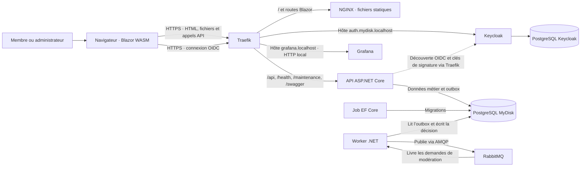
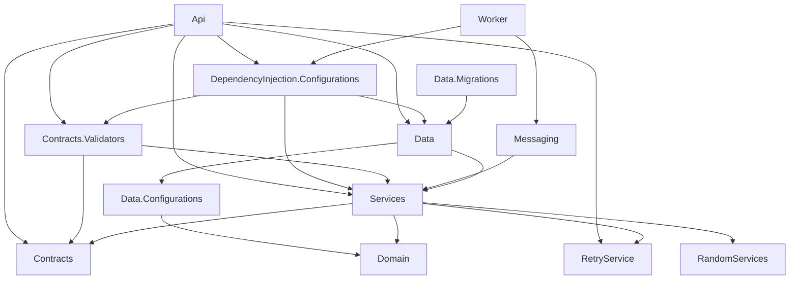
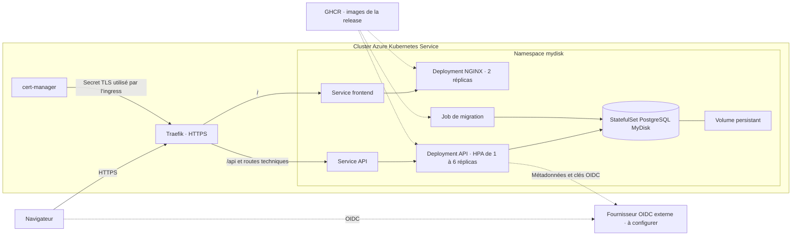
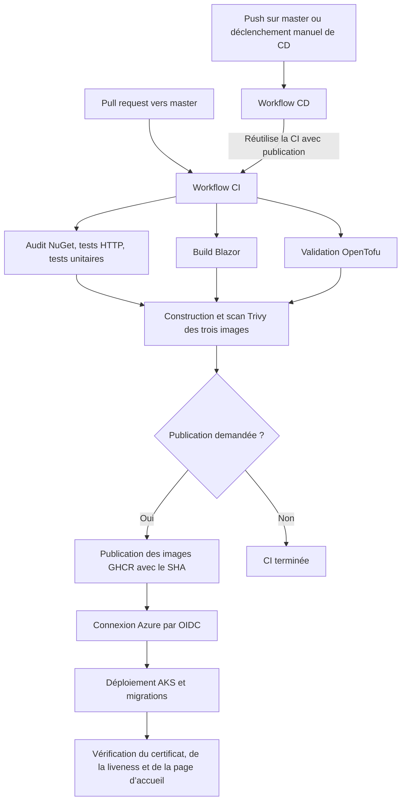
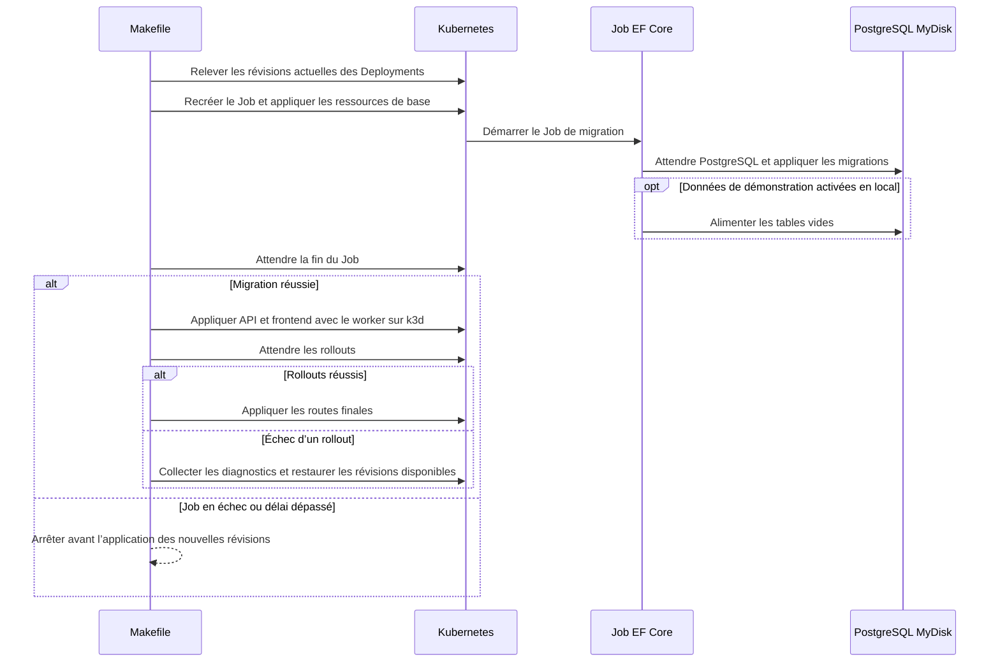

# Architecture de MyDisk

MyDisk gère des collections de disques, associe des artistes et permet de soumettre des avis. Le navigateur exécute le frontend Blazor WebAssembly. L’API ASP.NET Core porte les règles d’accès et les opérations métier, PostgreSQL conserve les données, et un worker séparé traite les avis en arrière-plan dans l’environnement local.

| Pour comprendre | Consulter |
| --- | --- |
| Les utilisateurs, les permissions et les échanges HTTP | [Cas d’utilisation et séquences](CAS-UTILISATION.md) |
| Les responsabilités des classes et le modèle de données | [Guide des classes](CLASSES.md) |
| La création, la publication et la modération d’un avis | [Worker et outbox](WORKER.md) |
| Les commandes de démarrage et de vérification | [README](../README.md#getting-started) |

## Contexte et composants

La vue ci-dessous montre les composants du déploiement local. Le même navigateur télécharge les fichiers statiques puis exécute Blazor. L’application s’adresse à l’API par la même origine. Le flux OpenID Connect passe par le nom d’hôte de Keycloak. [Routage HTTPS](../deploy/k8s/routing/https-routes.yml) · [Configuration TLS et DNS local](../infra/HTTPS.md#local-k3d-https)

L’API enregistre l’avis et le message d’outbox dans PostgreSQL dans la même transaction. Le worker relaie ensuite le message à RabbitMQ et traite sa livraison. Le navigateur récupère le statut par HTTP. Une interruption du worker ou du broker peut retarder la décision tout en laissant l’API accepter l’avis tant que ses propres dépendances répondent. [Détail de la modération et des reprises](WORKER.md)

## Dépendances du backend

Les flèches représentent les références directes entre projets .NET pour le chemin métier. `Api` et `Worker` sont les points d’entrée à l’exécution. Ils appellent `RegisterApplicationServices` pour configurer la validation, MediatR, les dépôts et EF Core. Les dépendances techniques vers les bibliothèques NuGet sont décrites dans les fichiers projet. [Solution backend](../apps/api/mydisk-api.sln) · [Enregistrement partagé](../apps/api/src/DependencyInjection.Configurations/ServiceCollectionExtensions.cs)

- `Contracts` définit les données échangées à la frontière HTTP. `Services` traduit les commandes et requêtes en opérations métier. `Domain` porte les entités, les règles et les interfaces de dépôts.
- `Data` implémente les dépôts et l’unité de travail. `Data.Configurations` fixe les mappings EF Core. `Data.Migrations` contient l’historique du schéma et le point d’entrée de conception utilisé par le bundle.
- `Messaging` relie l’outbox et les commandes de modération à RabbitMQ. `Worker` héberge ces traitements. Le frontend possède ses modèles de transport et rejoint le backend par HTTP.

[Responsabilités des classes](CLASSES.md) · [Définition du pipeline MediatR](../apps/api/src/Services/DependencyInjection.cs)

## Déploiements

| Élément | k3d local | AKS, overlay cloud |
| --- | --- | --- |
| Composition | Namespace `default`, Traefik de k3s, application, Keycloak, Grafana et RabbitMQ | Namespace `mydisk`, API, frontend et PostgreSQL. Traefik et cert-manager proviennent de la configuration OpenTofu du cluster |
| TLS | Certificats mkcert, HTTPS sur le port hôte 8443, CA locale montée dans le pod API pour la découverte Keycloak | Certificat géré par cert-manager et Let’s Encrypt |
| Identité | Keycloak et son PostgreSQL dédiés. Le navigateur et le pod API utilisent le même nom d’émetteur | Fournisseur OIDC accessible à configurer dans le frontend et l’API |
| Modération | Un déploiement `mydisk-worker` et un StatefulSet RabbitMQ, avec stockage persistant du broker | Worker retiré par l’overlay et RabbitMQ absent. Les avis créés restent `Pending`, et leurs messages restent dans l’outbox |
| Données | PostgreSQL MyDisk dans un StatefulSet avec volume persistant. Rôle applicatif partagé par API et worker, rôle distinct pour le Job de migration. Données de démonstration activées | PostgreSQL MyDisk et rôle de migration identiques dans la structure. Données de démonstration désactivées par défaut |
| Images applicatives | Construites sur la machine de développement puis importées dans k3d | API, migrations et frontend tirés de GHCR. Le déploiement de release fixe leur tag |

[Overlay local](../deploy/k8s/local/kustomization.yml) · [Overlay AKS](../deploy/k8s/cloud/kustomization.yml) · [Différences de l’API sur AKS](../apps/api/k8s/overlays/cloud/kustomization.yml) · [Règles réseau PostgreSQL](../apps/api/k8s/base/postgres-network-policy.yml)

### Topologie AKS

Le HPA cible une utilisation CPU moyenne de 70 % de la ressource demandée par les pods de l’API. `/health/live` vérifie que le processus HTTP répond et `/health/ready` inclut PostgreSQL. La disponibilité de RabbitMQ et la progression des avis relèvent des métriques ou observations du traitement en arrière-plan. Grafana est installé en local avec une source Prometheus préconfigurée. L’installation de Prometheus et les tableaux de bord restent à intégrer. [HPA](../apps/api/k8s/base/api-hpa.yml) · [Sondes](../apps/api/k8s/base/api-deployment.yml) · [Prometheus](../platform/prometheus/README.md)

## Livraison et migrations

### Chaîne GitHub Actions

Le workflow CI s’exécute notamment sur les pull requests vers `master`. Le workflow CD le réutilise avec publication activée pour les pushes sur `master` et les déclenchements manuels de CD. L’infrastructure AKS est provisionnée indépendamment par OpenTofu. [Workflow CI](../.github/workflows/ci.yml) · [Workflow CD](../.github/workflows/cd.yml) · [Infrastructure et droits Azure](../infra/GITHUB-ACTIONS.md)

### Ordre de déploiement

Le flux partagé par `make k8s-apply` en local et `make k8s-deploy` sur AKS applique en dernier la version finale du routage. Si un frontend existe déjà, les routes qui dépendent du frontend peuvent être mises à jour avant son remplacement. [Makefile](../Makefile) · [Job de migration](../apps/api/k8s/base/api-migrations-job.yml)

Le rollback concerne les Deployments modifiés pendant l’opération et disposant d’une révision précédente. Les migrations appliquées restent dans PostgreSQL. [Expériences de déploiement et de rollback](../README.md#rolling-updates-and-rollback)
