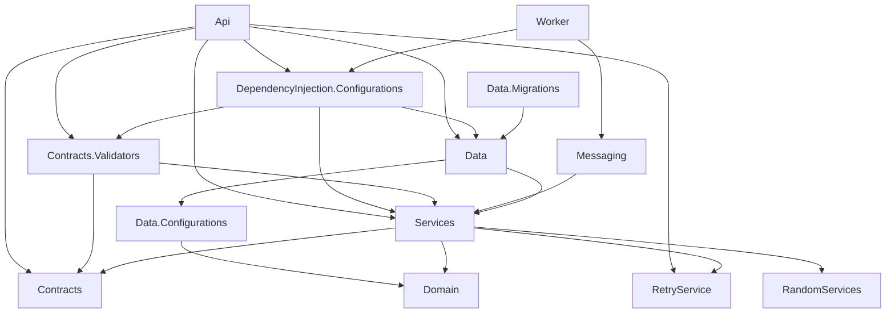
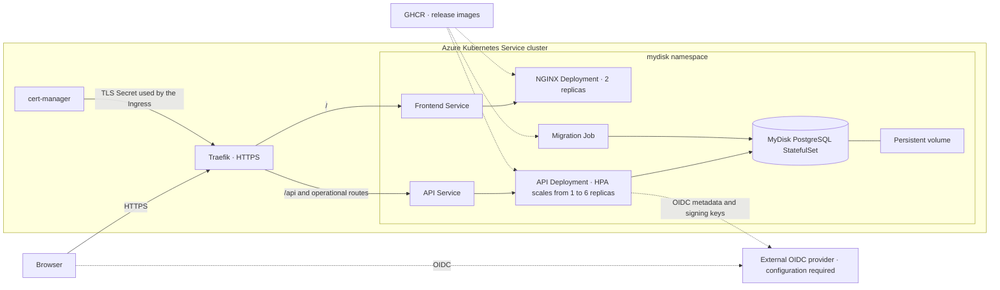
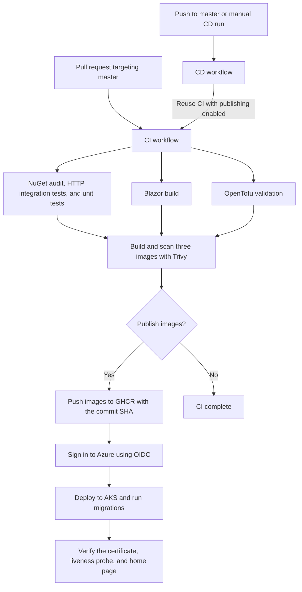
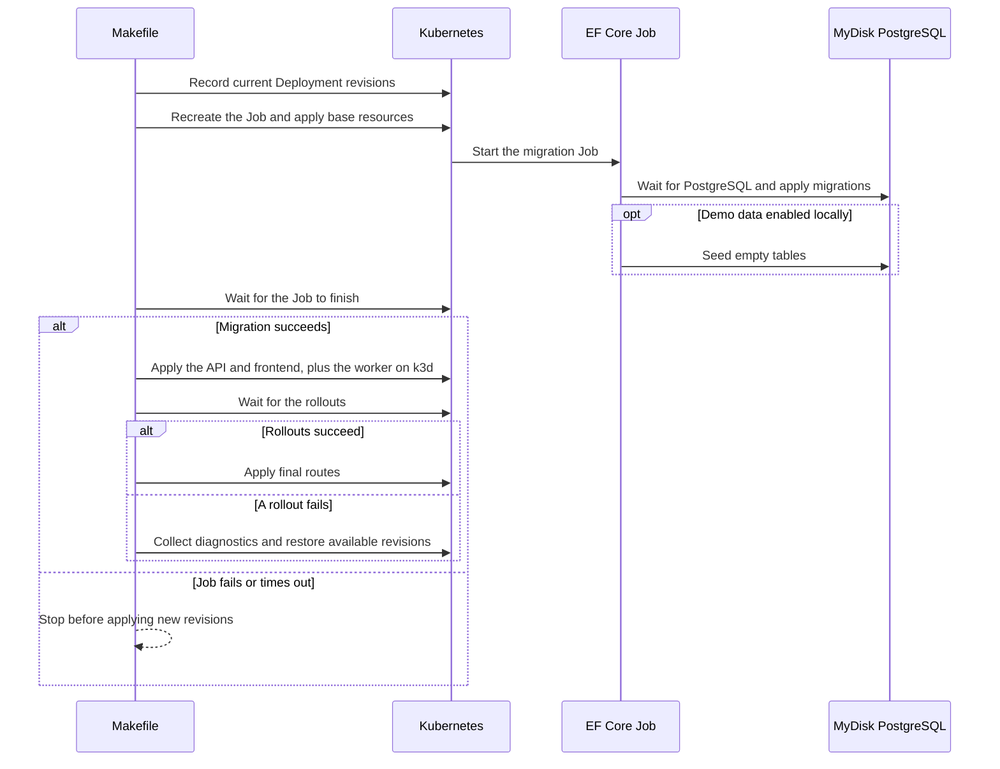

# MyDisk architecture

MyDisk lets members manage record collections, associate artists with records, and submit reviews. The browser runs the Blazor WebAssembly frontend. The ASP.NET Core API enforces access and business rules, PostgreSQL stores the data, and a separate worker moderates reviews in the background in the local environment.

| To learn about | See |
| --- | --- |
| Users, permissions, and HTTP flows | [Use cases and sequences](USE-CASES.md) |
| Class responsibilities and the data model | [Class guide](CLASSES.md) |
| Review submission, message publication, and moderation | [Worker and outbox](WORKER.md) |
| Startup and verification commands | [README](../README.md#getting-started) |

## System context and components

The diagram shows the local deployment. The browser downloads the static files and runs Blazor. The frontend calls the API on the same origin. OpenID Connect requests go to the Keycloak hostname. [HTTPS routing](../deploy/k8s/routing/https-routes.yml) · [Local TLS and DNS configuration](../infra/HTTPS.md#local-k3d-https)

The API writes the review and its outbox message to PostgreSQL in the same transaction. The worker publishes the message to RabbitMQ and then processes its delivery. The browser requests the review status over HTTP. If the worker or broker is unavailable, moderation can be delayed while the API continues to accept reviews as long as its own dependencies are available. [Moderation and retries](WORKER.md)

## Backend dependencies

Arrows show direct .NET project references. `Api` and `Worker` are the runtime entry points. Both call `RegisterApplicationServices` to configure validation, MediatR, repositories, and EF Core. The project files list the NuGet dependencies. [Backend solution](../apps/api/mydisk-api.sln) · [Shared service registration](../apps/api/src/DependencyInjection.Configurations/ServiceCollectionExtensions.cs)

- `Contracts` defines HTTP request and response types. `Services` implements application use cases as commands and queries. `Domain` contains entities, business rules, and repository interfaces.
- `Data` implements repositories and the unit of work. `Data.Configurations` defines EF Core mappings. `Data.Migrations` contains schema history and the design-time entry point used by the migration bundle.
- `Messaging` connects the outbox and moderation commands to RabbitMQ. `Worker` hosts the background services. The frontend has its own transport models and calls the API over HTTP.

[Class responsibilities](CLASSES.md) · [MediatR pipeline registration](../apps/api/src/Services/DependencyInjection.cs)

## Deployments

| Component | Local k3d | AKS cloud overlay |
| --- | --- | --- |
| Stack | The `default` namespace, k3s Traefik, the application, Keycloak, Grafana, and RabbitMQ | The `mydisk` namespace, API, frontend, and PostgreSQL. OpenTofu configures Traefik and cert-manager in the cluster |
| TLS | mkcert certificates, HTTPS on host port 8443, and a local CA mounted in the API pod for Keycloak discovery | A Let's Encrypt certificate managed by cert-manager |
| Identity | Keycloak with its own PostgreSQL instance. The browser and API pod use the same issuer hostname | A reachable OIDC provider that must be configured in both the frontend and API |
| Moderation | The `mydisk-worker` Deployment and a RabbitMQ StatefulSet with persistent broker storage | The overlay removes the worker and omits RabbitMQ. Submitted reviews stay `Pending` unless archived, and their messages remain in the outbox |
| Data | MyDisk PostgreSQL in a StatefulSet with a persistent volume. The API and worker share the application role, and the migration Job uses a separate role. Demo data is enabled | The same MyDisk PostgreSQL structure and dedicated migration role. Demo data is disabled by default |
| Application images | Built on the developer machine and imported into k3d | API, migration, and frontend images pulled from GHCR. The release deployment pins their tags |

[Local overlay](../deploy/k8s/local/kustomization.yml) · [AKS overlay](../deploy/k8s/cloud/kustomization.yml) · [AKS API configuration](../apps/api/k8s/overlays/cloud/kustomization.yml) · [PostgreSQL network policy](../apps/api/k8s/base/postgres-network-policy.yml)

### AKS topology

The HPA targets average CPU utilization of 70% of the CPU requested by the API pods. `/health/live` checks that the HTTP process responds, and `/health/ready` includes a PostgreSQL check. Worker logs can help track RabbitMQ connectivity and review decisions. Local Grafana has a preconfigured Prometheus data source. Prometheus installation and dashboards remain open work. [HPA](../apps/api/k8s/base/api-hpa.yml) · [Health probes](../apps/api/k8s/base/api-deployment.yml) · [Prometheus](../platform/prometheus/README.md)

## Delivery and migrations

### GitHub Actions pipeline

The CI workflow runs on pull requests targeting `master`. CD reuses it with image publishing enabled on pushes to `master` and manual CD runs. OpenTofu provisions the AKS infrastructure separately. [CI workflow](../.github/workflows/ci.yml) · [CD workflow](../.github/workflows/cd.yml) · [Azure infrastructure and permissions](../infra/GITHUB-ACTIONS.md)

### Deployment order

Both local `make k8s-apply` and AKS `make k8s-deploy` apply the final routing configuration after the rollout. If a frontend already exists, routes that depend on it can be updated before its replacement. [Makefile](../Makefile) · [Migration Job](../apps/api/k8s/base/api-migrations-job.yml)

Rollback restores changed Deployments that have a previous revision. Applied migrations remain in PostgreSQL. [Rollout and rollback experiments](../README.md#rolling-updates-and-rollback)
