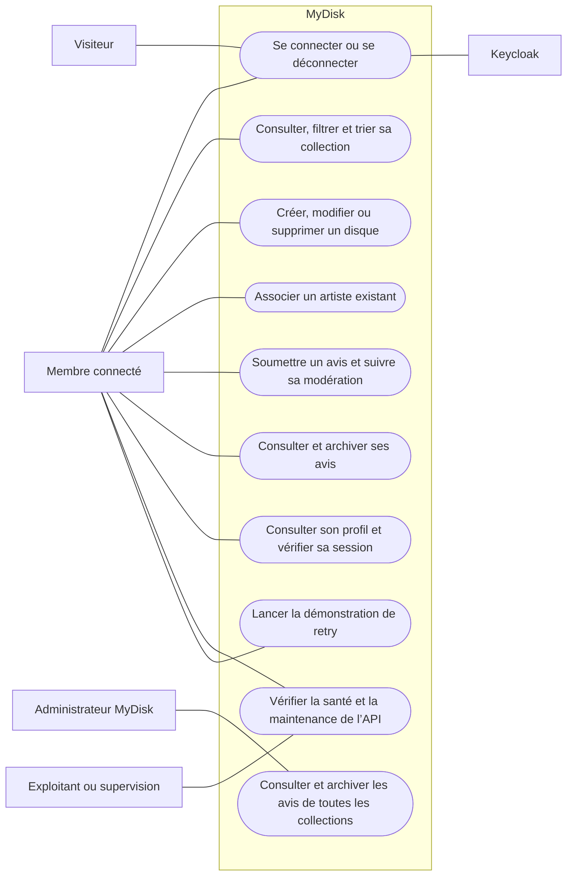
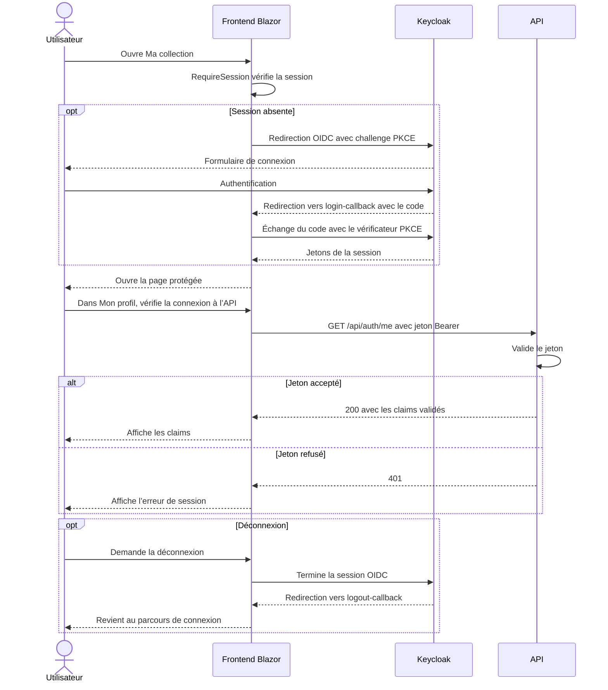
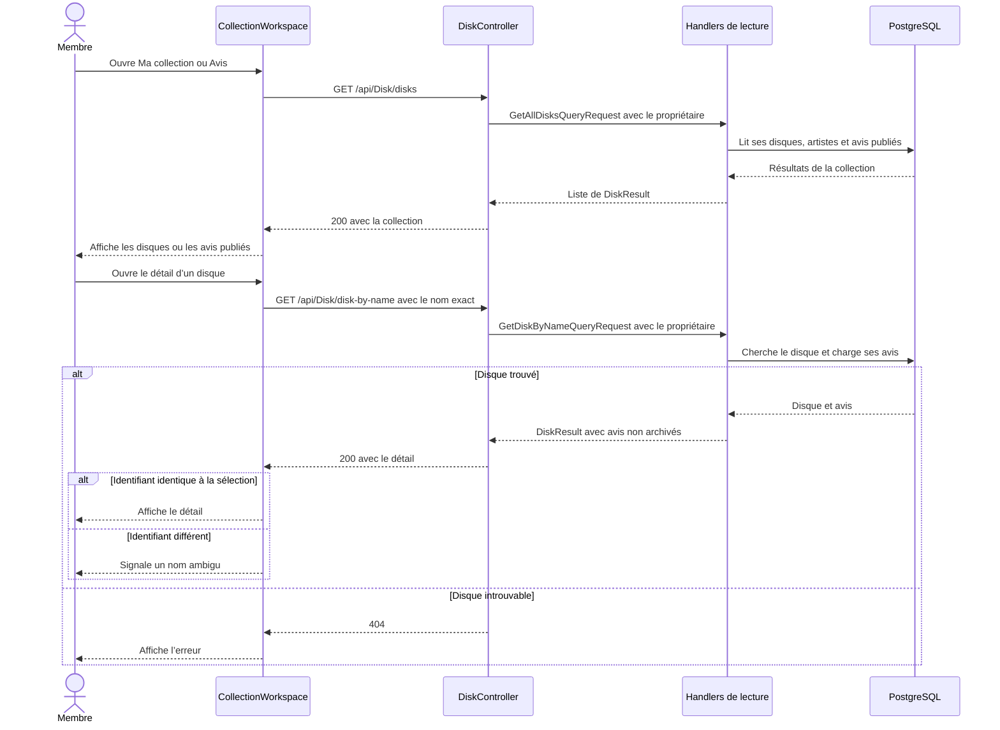
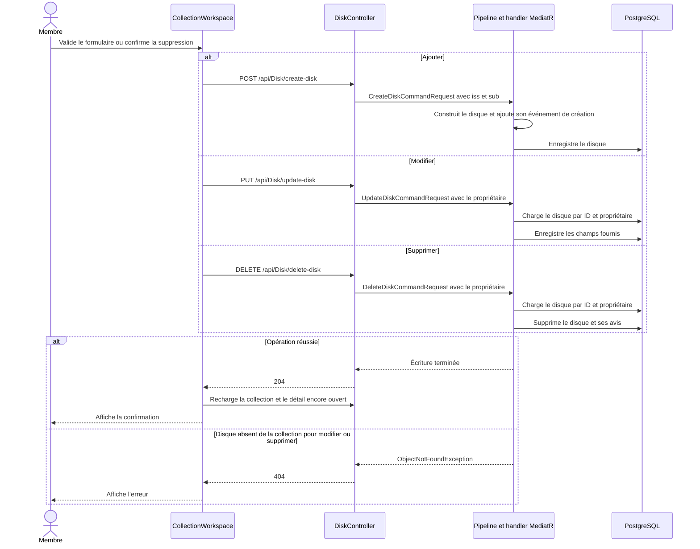
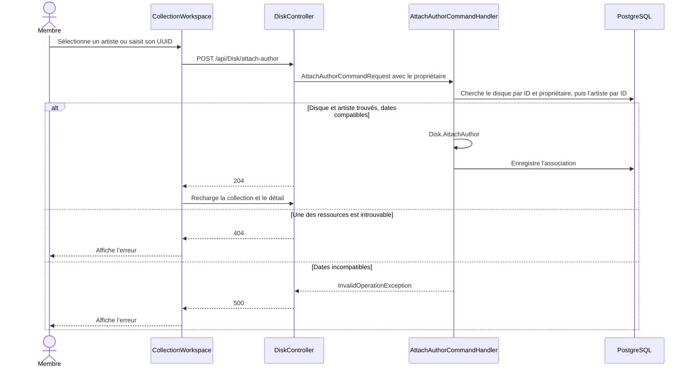
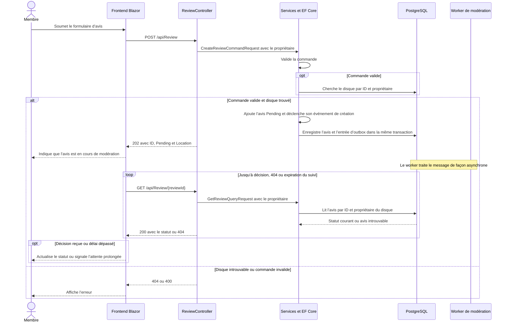
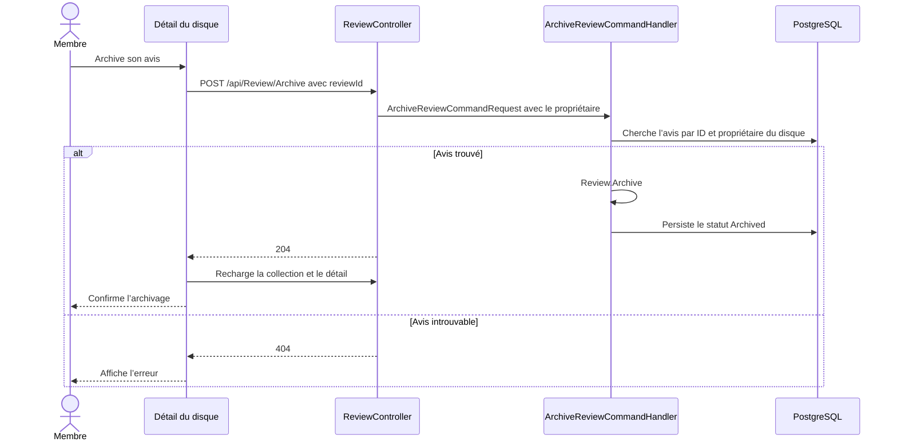
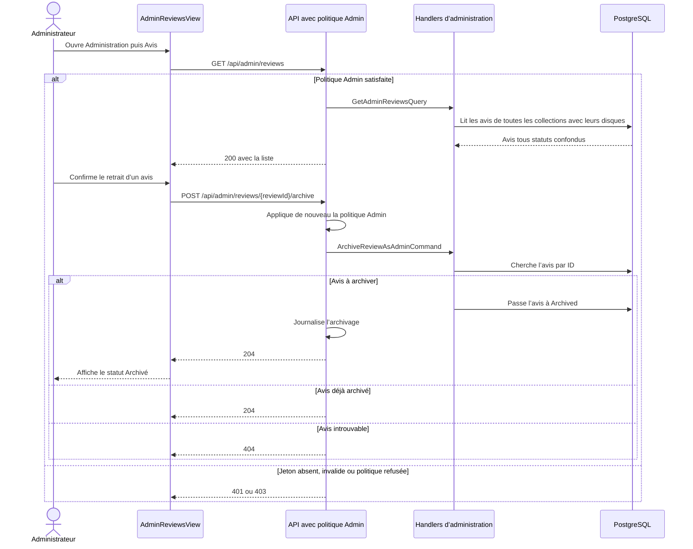
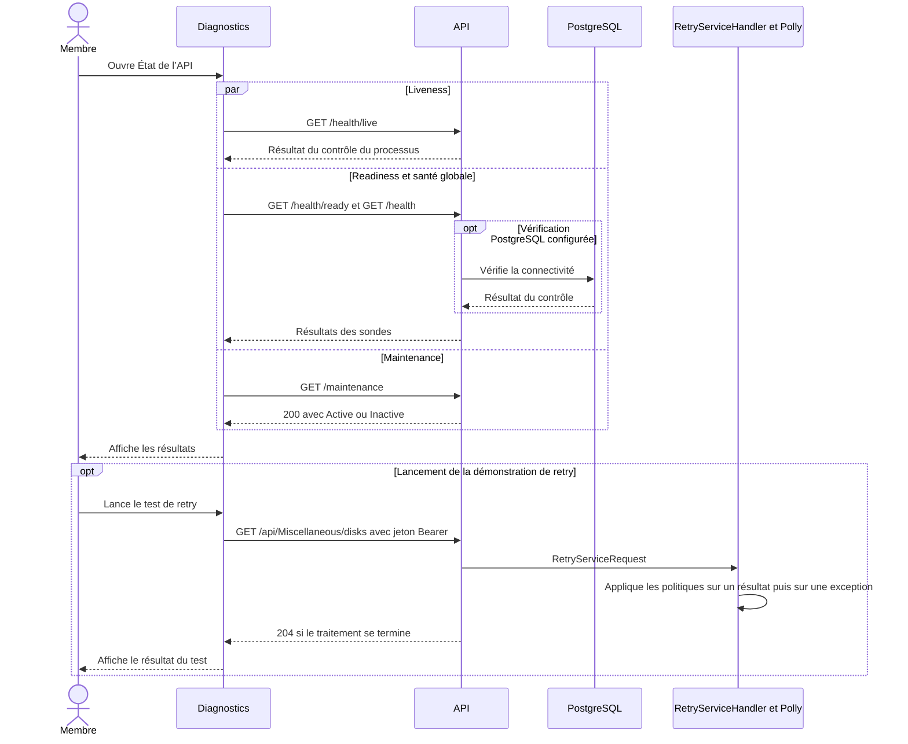

# Cas d’utilisation de MyDisk

MyDisk permet à chaque compte de gérer sa collection de disques et ses avis. Le rôle `admin` donne accès à un écran d’administration des avis de toutes les collections. Ce guide relie les actions de l’interface aux routes HTTP et aux traitements qui les exécutent. [Architecture](ARCHITECTURE.md) · [Responsabilités des classes](CLASSES.md) · [Worker et modération](WORKER.md)

## Acteurs et cas d’utilisation

| Acteur | Actions |
| --- | --- |
| Visiteur | Se connecter via Keycloak. Les sondes HTTP sont aussi accessibles sans session. |
| Membre | Gérer sa collection, soumettre et archiver ses avis, consulter leur statut, vérifier sa session et consulter l’état de l’API. |
| Administrateur MyDisk | Utiliser les fonctions de membre et consulter ou archiver les avis de toutes les collections avec le rôle client `admin`. |
| Exploitant ou client de supervision | Interroger les sondes de santé et l’indicateur de maintenance. Un développeur peut consulter le contrat HTTP dans Swagger. |
| Keycloak | Authentifier le compte, émettre les jetons et terminer la session à la déconnexion. |

L’API identifie le propriétaire à partir du couple `iss` / `sub` du jeton validé. Les opérations personnelles filtrent sur ce propriétaire, y compris quand le compte possède le rôle `admin`. Une ressource absente de la collection du compte est traitée comme introuvable. Les anciens disques dont le propriétaire n’est pas renseigné restent hors des collections personnelles. [Identité du propriétaire](../apps/api/src/Api/Controllers/DiskOwnerClaims.cs) · [Tests d’isolation](../apps/api/src/Api.IntegrationTests/Controllers/PrivateCollectionFixture.cs)

## Routes HTTP

| Action | Méthode et route | Accès | Réponse nominale |
| --- | --- | --- | --- |
| Vérifier le jeton présenté à l’API | `GET /api/auth/me` | Jeton valide | `200` et claims |
| Lister les disques et leurs avis publiés | `GET /api/Disk/disks` | Propriétaire | `200` et liste, éventuellement vide |
| Consulter un disque par son nom exact | `GET /api/Disk/disk-by-name?name=…` | Propriétaire | `200` et détail du disque |
| Ajouter un disque | `POST /api/Disk/create-disk` | Session avec `iss` et `sub` | `204` |
| Modifier un disque | `PUT /api/Disk/update-disk` | Propriétaire | `204` |
| Supprimer un disque | `DELETE /api/Disk/delete-disk?diskId=…` | Propriétaire | `204` |
| Associer un artiste | `POST /api/Disk/attach-author` | Propriétaire | `204` |
| Soumettre un avis | `POST /api/Review` | Propriétaire du disque | `202` avec l’identifiant, `Pending` et un en-tête `Location` |
| Consulter un avis par identifiant | `GET /api/Review/{reviewId}` | Propriétaire du disque | `200` et détail de l’avis |
| Archiver un avis depuis le détail du disque | `POST /api/Review/Archive` | Propriétaire du disque | `204` |
| Lister les avis de toutes les collections | `GET /api/admin/reviews` | Rôle `admin` | `200` et liste tous statuts confondus |
| Archiver un avis depuis l’administration | `POST /api/admin/reviews/{reviewId}/archive` | Rôle `admin` | `204` |
| Tester le processus, la disponibilité ou la santé globale | `GET /health/live`, `GET /health/ready`, `GET /health` | Public | `200` et `Healthy` si la sonde réussit |
| Lire l’état de maintenance | `GET /maintenance` | Public | `200` avec `Active` ou `Inactive` |
| Déclencher la démonstration de retry | `GET /api/Miscellaneous/disks` | Jeton valide | `204` si l’exercice se termine |
| Explorer le contrat HTTP | `GET /swagger/index.html` | Public | `200` et interface Swagger UI |

Les routes protégées répondent `401` si l’authentification échoue. Une session valide sans les claims requis pour l’opération reçoit `403`. Les validations FluentValidation et les erreurs de format traitées par le filtre MVC renvoient `400`. Le filtre convertit les ressources introuvables en `404`. En mode maintenance, le filtre bloque les actions MVC concernées avec `503`. [Contrôleurs](../apps/api/src/Api/Controllers/) · [Validation JWT et politique Admin](../apps/api/src/Api/KeycloakAuthentication.cs) · [Filtres MVC](../apps/api/src/Api/Filters/)

## Connexion, profil et déconnexion

Toutes les pages fonctionnelles du frontend passent par `RequireSession`. Le client public Keycloak utilise le flux OIDC Authorization Code avec PKCE S256 dans la configuration locale. Les appels protégés suivants emploient un jeton d’accès dont l’API valide la signature, l’expiration, l’émetteur et l’audience. Le profil affiche les claims de la session Blazor et offre une vérification distincte des claims du jeton reçu par l’API. [Routage Blazor](../apps/frontend/src/App.razor) · [Realm local](../apps/keycloak/k8s/overlays/local/mydisk-realm.json) · [Profil](../apps/frontend/src/Pages/ProfilePage.razor)

## Liste de collection et détail d’un disque

La page **Ma collection** filtre côté navigateur par nom de disque ou pseudonyme d’artiste et trie par nom ou date de sortie. La page **Avis** part de la même liste privée et affiche ses avis publiés. Le détail d’un disque peut également afficher les avis en attente et rejetés. Les avis archivés sont écartés du résultat disque. La recherche du détail se fait par nom exact. Si plusieurs disques partagent un nom et que l’identifiant renvoyé diffère de la sélection, l’interface affiche un message d’ambiguïté. [Navigation et chargement](../apps/frontend/src/Components/CollectionWorkspace.razor.cs) · [Dépôt EF Core](../apps/api/src/Data/DiskRepository.cs) · [Projection du disque](../apps/api/src/Services/Disks/MapperProfiles.cs)

## Création, modification et suppression d’un disque

Le formulaire Blazor demande un nom de 30 caractères au maximum et une date de sortie. À la création, le serveur prend le propriétaire dans le jeton et crée un `NewDiskCreatedDomainEvent`, dont le gestionnaire journalise l’identifiant pendant la sauvegarde EF Core. La mise à jour API applique les champs fournis. La suppression nécessite une confirmation dans l’interface et entraîne la suppression en cascade des avis du disque. [Éditeur Blazor](../apps/frontend/src/Components/DiskEditor.razor.cs) · [Commandes disques](../apps/api/src/Services/Disks/) · [Relation disque et avis](../apps/api/src/Data.Configurations/Reviews/ReviewConfiguration.cs)

## Association d’un artiste existant

Dans le détail, l’utilisateur sélectionne un artiste déjà présent dans les disques chargés ou saisit son UUID. Le serveur charge le disque du compte et l’artiste correspondant. `Disk.AttachAuthor` exige que la date de naissance de l’artiste précède la date de sortie lorsqu’elle est renseignée. [Formulaire d’association](../apps/frontend/src/Components/DiskDetail.razor.cs) · [Handler](../apps/api/src/Services/Disks/AttachAuthorCommandHandler.cs) · [Règle de domaine](../apps/api/src/Domain/Disks/Disk.cs)

## Soumission et suivi d’un avis

Le formulaire recueille un titre de 30 caractères au maximum, un texte et une note de 0 à 5. L’interface masque le formulaire jusqu’à la date de sortie du disque. Cette règle de date s’applique dans la fiche Blazor. La création enregistre l’avis `Pending` et son message d’outbox dans la même transaction, puis renvoie `202`. Le frontend interroge le statut par identifiant avec un délai progressif et aléatoire, selon une échéance de 60 secondes vérifiée entre les tentatives. Il s’arrête lorsque l’avis quitte `Pending` ou que l’API répond `404`. Rouvrir le détail d’un disque relance le suivi des avis toujours en attente. [Fiche Blazor](../apps/frontend/src/Components/DiskDetail.razor) · [Contrôleur](../apps/api/src/Api/Controllers/ReviewController.Post.cs) · [Suivi dans Blazor](../apps/frontend/src/Services/ReviewModerationWatcher.cs) · [Publication et consommation du message](WORKER.md)

## Archivage d’un avis par son propriétaire

L’action de la fiche disque passe par la même vérification de propriété que la lecture directe. Elle change le statut à `Archived`. Un avis archivé disparaît de la fiche et de la liste des avis publiés au rechargement. Il reste consultable par son propriétaire via la route de lecture directe et reste visible dans la liste d’administration. [Handler d’archivage](../apps/api/src/Services/Reviews/ArchiveReviewCommandHandler.cs) · [Handler de lecture](../apps/api/src/Services/Reviews/GetReviewQueryHandler.cs) · [Projection du disque](../apps/api/src/Services/Disks/MapperProfiles.cs)

## Administration des avis

Le frontend affiche l’entrée **Administration → Avis** aux comptes pour lesquels `mydisk_roles` contient `admin`. Le contrôleur applique sa propre politique `Admin` sur le JWT et exige aussi `sub`. La liste inclut tous les statuts et le nom du disque. Lors d’un premier archivage, le contrôleur journalise l’émetteur, le sujet et l’identifiant de l’avis après l’écriture. Répéter l’opération sur un avis déjà archivé renvoie également `204`, sans nouvelle écriture de l’avis. [Écran d’administration](../apps/frontend/src/Components/AdminReviewsView.razor) · [Contrôleur](../apps/api/src/Api/Controllers/AdminReviewsController.cs) · [Handler](../apps/api/src/Services/Reviews/ArchiveReviewAsAdminCommand.cs)

## Sondes, maintenance et démonstration de retry

L’écran **État de l’API** appelle les trois sondes ainsi que `/maintenance` en parallèle. `/health/live` vérifie que le processus HTTP répond. `/health/ready` exécute la vérification PostgreSQL lorsque la connexion est configurée et `/health` agrège les vérifications enregistrées. Le mode `MaintenanceSettings:Global` bloque les actions MVC soumises au filtre. Les sondes, `/maintenance` et la route minimale `/api/auth/me` restent accessibles selon leurs règles d’accès habituelles. [Sondes et routes](../apps/api/src/Api/Program.cs) · [Enregistrement du contrôle PostgreSQL](../apps/api/src/Api/DependencyInjection.cs) · [Écran État de l’API](../apps/frontend/src/Components/Diagnostics.razor.cs)

La démonstration exécute deux scénarios aléatoires via `PollyRetryService`, avec un nombre de reprises et un délai configurables via `RetryServiceSettings`. Les politiques de reprise du flux de modération sont documentées avec le worker. [Scénarios de démonstration](../apps/api/src/Services/Miscellaneous/RetryServiceHandler.cs) · [Implémentation Polly](../apps/api/src/RetryService/PollyRetryService.cs) · [Reprises du worker](WORKER.md)
