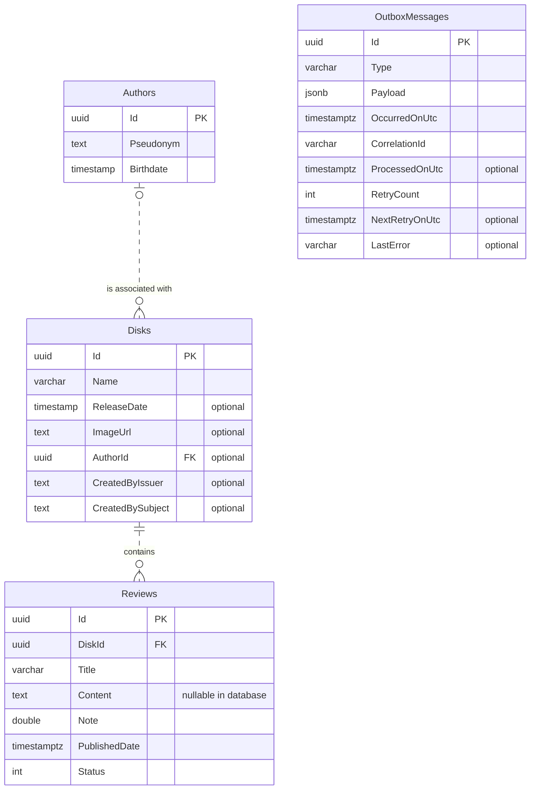
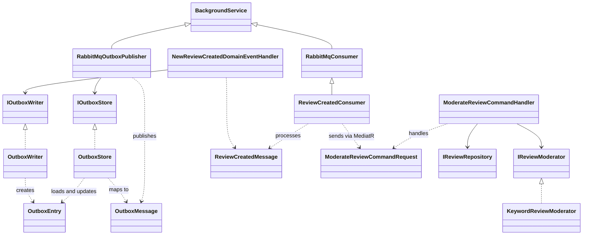

# Classes and data model

The [architecture overview](ARCHITECTURE.md) describes the deployed components. The [use cases](USE-CASES.md) trace the calls between them. This page describes how the API, worker, and frontend divide responsibilities in code.

## Domain

The `Domain` project defines the entities, value objects, events, and repository interfaces. These classes represent the business concepts used by the handlers.

| Class | Responsibility |
| --- | --- |
| `Entity<TId>` and `AggregateRoot<TId>` | `Entity` provides an identifier, compares entities by identifier, and holds pending domain events. `AggregateRoot` is the base class for `Disk`, `Author`, and `Review`. [Code](../apps/api/src/Domain/) |
| `Disk` | Represents a record and its owner. When a release date is known, `AttachAuthor` checks that the artist was born before the record was released. `AddReview` checks for duplicates before adding a review. [Code](../apps/api/src/Domain/Disks/Disk.cs) |
| `Author` | Represents an artist associated with one or more records. It stores a pseudonym and a date of birth. [Code](../apps/api/src/Domain/Authors/Author.cs) |
| `Review` | Stores the review title, content, rating, and status. Titles are limited to 30 characters and ratings range from 0 to 5. The constructor sets the status to `Pending` and initializes `PublishedDate` to the creation time. `Publish` and `Reject` require `Pending`. `Archive` sets the status to `Archived`. [Code](../apps/api/src/Domain/Reviews/Review.cs) |
| `ValueObject`, `Name` and `Pseudonym` | `ValueObject` compares objects by their component values. `Name` requires between 1 and 30 characters. `Pseudonym` limits the value to 30 characters. [Base](../apps/api/src/Domain/ValueObject.cs) · [Name](../apps/api/src/Domain/Disks/Name.cs) · [Pseudonym](../apps/api/src/Domain/Authors/Pseudonym.cs) |
| `NewDiskCreatedDomainEvent` and `NewReviewCreatedDomainEvent` | Carry the data that internal event handlers need when a record or review is created. [Record](../apps/api/src/Domain/Disks/NewDiskCreatedDomainEvent.cs) · [Review](../apps/api/src/Domain/Reviews/NewReviewCreatedDomainEvent.cs) |

## HTTP and use cases

### API

| Class | Responsibility |
| --- | --- |
| `Api.Program` | Starts ASP.NET Core, configures the pipeline, and maps the controllers, Swagger, health probes, and `/api/auth/me`. [Code](../apps/api/src/Api/Program.cs) |
| `DiskController` | Lists records, looks them up by exact name, and creates, updates, deletes, or associates them with an artist in the signed-in user's collection. [Code](../apps/api/src/Api/Controllers/) |
| `ReviewController` | Accepts submissions with `202 Accepted` and lets users read the status or archive reviews of records they own. [Code](../apps/api/src/Api/Controllers/) |
| `AdminReviewsController` | Lists and archives reviews across all collections under the `Admin` policy. It logs the administrator's identity when archiving changes a review's status. [Code](../apps/api/src/Api/Controllers/AdminReviewsController.cs) |
| `KeycloakAuthentication` and `DiskOwnerClaims` | `KeycloakAuthentication` configures JWT validation and the `Admin` policy. `DiskOwnerClaims` builds the `DiskOwner` passed to collection handlers from the `iss` and `sub` claims. [JWT](../apps/api/src/Api/KeycloakAuthentication.cs) · [Identity](../apps/api/src/Api/Controllers/DiskOwnerClaims.cs) |
| `MaintenanceController`, `MaintenanceHelper` and `MaintenanceFilterAttribute` | The controller reports status at `/maintenance`. The filter returns `503` for applicable MVC actions when maintenance is active or the options are unavailable. `IgnoreMaintenanceFilterAttribute` lets the status endpoint respond during maintenance. [Controller](../apps/api/src/Api/Controllers/MaintenanceController.cs) · [Filter](../apps/api/src/Api/Filters/MaintenanceFilterAttribute.cs) |
| `ApiExceptionFilterAttribute` | Translates recognized exceptions into HTTP responses. Validation and format errors return `400`, a missing resource returns `404`, and missing ownership claims return `403`. [Code](../apps/api/src/Api/Filters/ApiExceptionFilterAttribute.cs) |
| `SwaggerAuthorizationFilter` | Documents the Bearer token requirement for protected actions in Swagger. [Code](../apps/api/src/Api/Filters/SwaggerAuthorizationFilter.cs) |
| `MiscellaneousController` | Exposes the retry demonstration at `GET /api/Miscellaneous/disks`. [Code](../apps/api/src/Api/Controllers/MiscellaneousController.cs) |

### Requests, validation, and handlers

The DTOs in `Contracts` define HTTP inputs and outputs. Request types in `Services` add the MediatR contract and carry the signed-in identity for collection operations. The AutoMapper profiles in `Services` map domain objects to response DTOs. [Contracts](../apps/api/src/Contracts/) · [Services](../apps/api/src/Services/)

| Class | Responsibility |
| --- | --- |
| `ValidationBehaviour<TRequest, TResponse>` | Runs the FluentValidation validators for a request before passing it to the next pipeline behavior. The validators check required inputs, UUIDs, and the rating range, among other rules. [Behavior](../apps/api/src/Services/Behaviors/ValidationBehaviour.cs) · [Validators](../apps/api/src/Contracts.Validators/) |
| `TransactionBehavior<TRequest, TResponse>` | Opens a transaction through `IUnitOfWork`, runs the handler, calls `CommitAsync`, and requests a rollback if an exception propagates. The open generic registration also covers queries. Some handlers call `CommitAsync` themselves. [Behavior](../apps/api/src/Services/Behaviors/TransactionBehaviour.cs) · [Registration](../apps/api/src/Services/DependencyInjection.cs) |
| `LoggingPreProcessorBehaviour` and `LoggingPostProcessorBehaviour` | Provide logging hooks around a MediatR request. The current pipeline configuration explicitly registers the validation and transaction behaviors. [Code](../apps/api/src/Services/Behaviors/) |
| `GetAllDisksQueryHandler` and `GetDiskByNameQueryHandler` | Filter records by `iss` and `sub`. The list query includes published reviews. The detail query looks up an exact name and excludes archived reviews when mapping the result. [Handlers and mapping profile](../apps/api/src/Services/Disks/) |
| `CreateDiskCommandHandler`, `UpdateDiskCommandHandler`, `DeleteDiskCommandHandler` | Create a record under the signed-in account, update supplied fields, or delete a record. Updates and deletes look up the UUID within that account's collection. [Code](../apps/api/src/Services/Disks/) |
| `AttachAuthorCommandHandler` and `CreateAuthorCommandHandler` | `AttachAuthorCommandHandler` looks up a record owned by the account and an existing artist, then calls `Disk.AttachAuthor`. `CreateAuthorCommandHandler` creates an artist from a pseudonym and date of birth as an internal MediatR operation. [Attach artist](../apps/api/src/Services/Disks/AttachAuthorCommandHandler.cs) · [Create artist](../apps/api/src/Services/Authors/CreateAuthorCommandHandler.cs) |
| `CreateReviewCommandHandler`, `GetReviewQueryHandler`, `ArchiveReviewCommandHandler` | Create a review and its domain event, look up a review's status, or archive it. Each operation checks ownership through the associated record. [Code](../apps/api/src/Services/Reviews/) |
| `GetAdminReviewsQueryHandler` and `ArchiveReviewAsAdminCommandHandler` | Return reviews with record names for the administration view and archive reviews by UUID. The archive handler indicates whether the status changed. [List](../apps/api/src/Services/Reviews/GetAdminReviewsQuery.cs) · [Archive](../apps/api/src/Services/Reviews/ArchiveReviewAsAdminCommand.cs) |
| `NewDiskCreatedDomainEventHandler` | Logs the record's creation when the domain event is dispatched. [Code](../apps/api/src/Services/Disks/NewDiskCreatedDomainEventHandler.cs) |
| `RetryServiceHandler`, `PollyRetryService` and `RandomService` | Demonstrate retrying an operation based on a result or an exception. `PollyRetryService` applies the configured retry count and delay. `RandomService` generates the result. [Demo](../apps/api/src/Services/Miscellaneous/RetryServiceHandler.cs) · [Polly](../apps/api/src/RetryService/) · [Random values](../apps/api/src/RandomServices/) |

## Persistence

| Class | Responsibility |
| --- | --- |
| `ApplicationDbContext` | Exposes EF Core entity sets, loads the mappings from `Data.Configurations`, and configures the save interceptor. The API and worker use the same Npgsql context definition. [Code](../apps/api/src/Data/ApplicationDbContext.cs) |
| `UnitOfWork` | Exposes the record and artist repositories and manages the current EF Core transaction. `CommitAsync` saves changes, then commits the transaction if one is open. [Code](../apps/api/src/Data/UnitOfWork.cs) |
| `DiskRepository` | Loads records with artists and reviews. The collection query loads published reviews, and the detail query loads all reviews for the record. The repository adds, updates, and removes records through EF Core change tracking. [Code](../apps/api/src/Data/DiskRepository.cs) |
| `AuthorRepository` and `ReviewRepository` | Implement the artist and review repository interfaces. `ReviewRepository` also loads reviews with their records for the administration view. [Artists](../apps/api/src/Data/AuthorRepository.cs) · [Review](../apps/api/src/Data/ReviewRepository.cs) |
| `EntitySaveChangesInterceptor` and `MediatRDomainEventDispatcher` | The interceptor collects pending events from tracked entities at the start of a save and clears them from the entities. The dispatcher then publishes them in-process through MediatR. [Interceptor](../apps/api/src/Data/EntitySaveChangesInterceptor.cs) · [Dispatcher](../apps/api/src/Services/MediatRDomainEventDispatcher.cs) |
| `DiskConfiguration`, `AuthorConfiguration`, `ReviewConfiguration`, `OutboxConfiguration` | Define the value conversions, relationships, constraints, and indexes for each table. `NewIdGenerator` generates UUIDs using MassTransit NewId. [Code](../apps/api/src/Data.Configurations/) |
| `ApplicationDbContextFactory` and `DataSeeder` | The factory creates the context for migrations. With `SEED_DATA=true`, the seeder adds demo artists and records when their tables are empty. [Factory](../apps/api/src/Data.Migrations/ApplicationDbContextFactory.cs) · [Seeder](../apps/api/src/Data/DataSeeder.cs) |

### PostgreSQL schema

- Deleting an artist sets `AuthorId` to `NULL`. Deleting a record cascades to its reviews. [EF Core mappings](../apps/api/src/Data.Configurations/)
- `CreatedByIssuer` and `CreatedBySubject` are set together. Both columns can be `NULL` for historical or demo data. The OIDC provider manages identities. [PostgreSQL constraint](../apps/api/src/Data.Configurations/Disks/DiskConfiguration.cs)
- The outbox stores domain identifiers in the JSON payload. Its partial index on `OccurredOnUtc` and `Id` covers rows where `ProcessedOnUtc` is `NULL`. [Mapping](../apps/api/src/Data.Configurations/Outbox/OutboxConfiguration.cs) · [EF Core schema](../apps/api/src/Data.Migrations/Migrations/ApplicationDbContextModelSnapshot.cs)

## Worker and messaging

| Class | Responsibility |
| --- | --- |
| `Worker/Program.cs` and `Messaging.DependencyInjection` | The entry point configures the .NET host and registers the hosted services. RabbitMQ connection settings bind to `RabbitMqOptions` and are validated at startup. [Entry point](../apps/api/src/Worker/Program.cs) · [Registration](../apps/api/src/Messaging/DependencyInjection.cs) |
| `NewReviewCreatedDomainEventHandler` and `ReviewCreatedMessage` | The handler converts the internal event into a `review.created` message containing the review UUID, record UUID, and review timestamp. [Handler](../apps/api/src/Services/Reviews/NewReviewCreatedDomainEventHandler.cs) · [Message contract](../apps/api/src/Services/Reviews/ReviewCreatedMessage.cs) |
| `OutboxWriter`, `OutboxEntry` and `OutboxStore` | The writer serializes the message and adds its row to the same EF Core context as the review. The entry tracks errors and calculates the next retry time. The store selects eligible entries in batches, records each publication outcome, and saves their state. [Writer and store](../apps/api/src/Data/Messaging/) · [Entry](../apps/api/src/Data.Configurations/Outbox/OutboxEntry.cs) |
| `RabbitMqOutboxPublisher` | Polls the outbox, sends persistent messages to the RabbitMQ exchange, and waits for publisher confirmations. [Code](../apps/api/src/Messaging/RabbitMqOutboxPublisher.cs) |
| `RabbitMqConsumer<TMessage>` and `ReviewCreatedConsumer` | The base class handles connections, deserialization, and manual acknowledgments. The review consumer reads the `mydisk.review.created` queue and sends a `ModerateReviewCommandRequest` through MediatR. [Base](../apps/api/src/Messaging/RabbitMqConsumer.cs) · [Review consumer](../apps/api/src/Messaging/ReviewCreatedConsumer.cs) |
| `ModerateReviewCommandHandler` and `KeywordReviewModerator` | The handler looks up the review and applies the decision if its status is `Pending`. The moderator normalizes its title and content before checking for forbidden phrases. `ReviewModerationSettings` configures simulated latency. [Handler](../apps/api/src/Services/Reviews/ModerateReviewCommandHandler.cs) · [Moderator](../apps/api/src/Services/Reviews/Moderation/) |

`ServiceCollectionExtensions.RegisterApplicationServices` registers application services, persistence, and validators for both processes. The worker also registers the RabbitMQ hosted services. [Shared registration](../apps/api/src/DependencyInjection.Configurations/ServiceCollectionExtensions.cs) · [Worker sequences](WORKER.md)

## Blazor frontend

Razor components handle rendering and interactions in the browser. `DiskApiClient` centralizes HTTP calls to the API, and the types in `ApiModels.cs` define how responses are deserialized. [Frontend](../apps/frontend/src/) · [Models](../apps/frontend/src/Models/ApiModels.cs)

| Class or component | Responsibility |
| --- | --- |
| `Program.cs`, `App` and `AuthenticationSettings` | Configure the WebAssembly host, OIDC sign-in, the HTTP client, and routing. `App` uses `RequireSession` to protect application pages and reports when sign-in is unavailable because OIDC settings are missing. [Startup](../apps/frontend/src/Program.cs) · [Routing](../apps/frontend/src/App.razor) |
| `RequireSession`, `RedirectToLogin`, `Authentication` and `RoleClaimsPrincipalFactory` | Control access based on session state and handle sign-in navigation. The principal factory converts the OIDC role array into individual claims for `AuthorizeView`. [Session guard](../apps/frontend/src/Components/RequireSession.razor) · [Authentication page](../apps/frontend/src/Pages/Authentication.razor) · [Roles](../apps/frontend/src/Services/RoleClaimsPrincipalFactory.cs) |
| `DiskApiClient` | Builds requests, requires a Bearer token for calls under `/api`, and converts HTTP errors to `ApiException`. [Code](../apps/frontend/src/Services/DiskApiClient.cs) |
| `CollectionPage`, `ReviewsPage` and `CollectionWorkspace` | The pages use the same workspace to display the collection or its published reviews. The workspace loads data, verifies that the result of a name lookup matches the selected record, submits changes, and manages view state. [Pages](../apps/frontend/src/Pages/) · [Workspace](../apps/frontend/src/Components/CollectionWorkspace.razor.cs) |
| `CollectionView`, `PublishedReviewsView` and `AlbumArt` | Display the sortable, filterable collection, the published review list, and record artwork. [Code](../apps/frontend/src/Components/) |
| `DiskDetail`, `DiskEditor` and `ReviewStatusDisplay` | Handle the forms and actions for viewing and editing records. The parent component makes the HTTP calls. `ReviewStatusDisplay` provides labels and colors for review statuses. [Details](../apps/frontend/src/Components/DiskDetail.razor.cs) · [Editor](../apps/frontend/src/Components/DiskEditor.razor.cs) · [Statuses](../apps/frontend/src/Components/ReviewStatusDisplay.cs) |
| `ReviewModerationWatcher` | Polls a pending review's status with a growing delay between requests. `CollectionWorkspace` updates the view with the result. [Code](../apps/frontend/src/Services/ReviewModerationWatcher.cs) |
| `AdminReviewsPage` and `AdminReviewsView` | Show the full review list to administrators and request confirmation before archiving. The API enforces the access policy. [Page](../apps/frontend/src/Pages/AdminReviewsPage.razor) · [View](../apps/frontend/src/Components/AdminReviewsView.razor) |
| `ApiStatusPage`, `Diagnostics`, `ProfilePage` and `ClaimsTable` | Show API health, the Polly retry demonstration, claims from the browser session, and claims accepted by the API. [Diagnostics](../apps/frontend/src/Components/Diagnostics.razor.cs) · [Profile](../apps/frontend/src/Pages/ProfilePage.razor) |
| `MainLayout`, `AuthenticationLayout` and `UiTheme` | Provide page layouts, navigation, and the MudBlazor theme. [Code](../apps/frontend/src/Layout/) |
