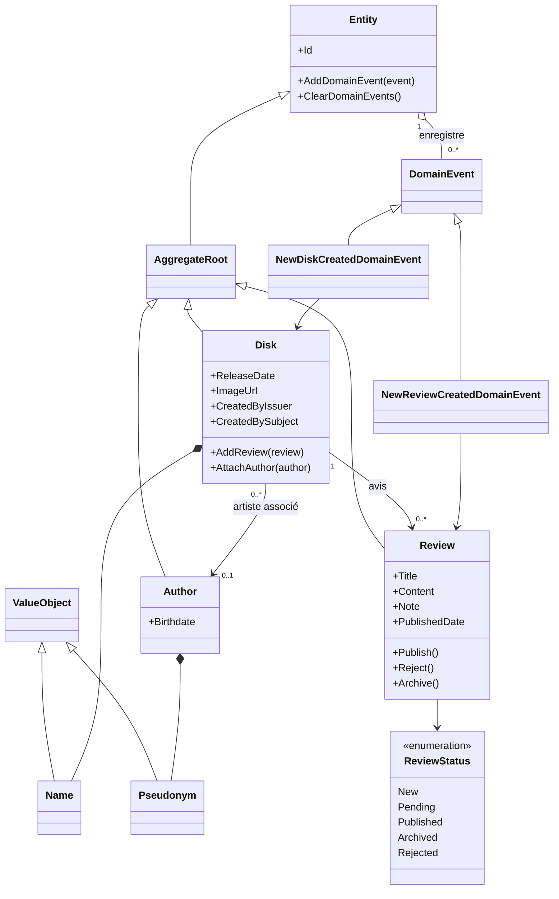
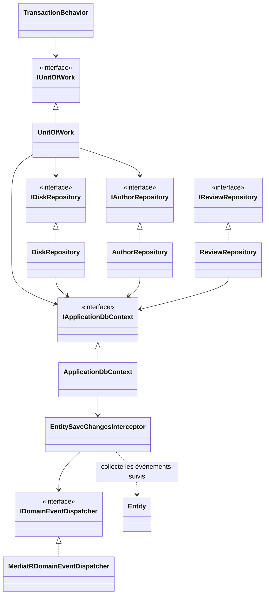
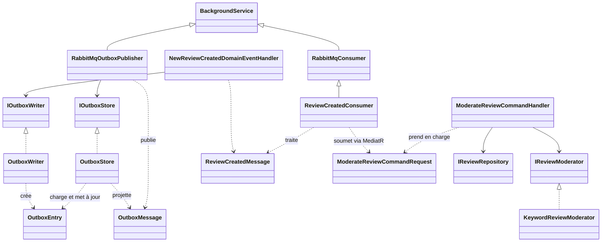
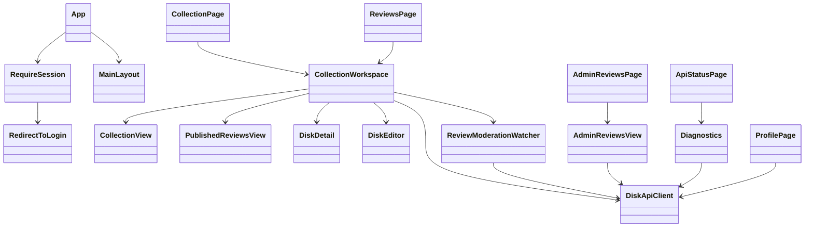

# Classes et modèle de données

La [vue d’architecture](ARCHITECTURE.md) présente les composants déployés. Les [cas d’utilisation](CAS-UTILISATION.md) suivent les appels entre ces composants. Cette page détaille les responsabilités dans le code de l’API, du worker et de l’interface.

## Domaine

`Domain` porte les entités, les objets-valeurs, les événements et les interfaces de dépôt. Les classes suivantes représentent les concepts métier utilisés par les gestionnaires.

| Classe | Responsabilité |
| --- | --- |
| `Entity<TId>` et `AggregateRoot<TId>` | `Entity` fournit l’identifiant, l’égalité par identifiant et la collection d’événements en attente. `AggregateRoot` sert de base à `Disk`, `Author` et `Review`. [Code](../apps/api/src/Domain/) |
| `Disk` | Représente un disque et son propriétaire. `AttachAuthor` contrôle que la naissance de l’artiste précède la sortie du disque lorsque la date de sortie existe. `AddReview` vérifie que l’avis est absent de la collection avant de l’ajouter. [Code](../apps/api/src/Domain/Disks/Disk.cs) |
| `Author` | Représente l’artiste associé à un ou plusieurs disques. Il porte un pseudonyme et une date de naissance. [Code](../apps/api/src/Domain/Authors/Author.cs) |
| `Review` | Porte le titre, le contenu, la note et le statut d’un avis. Le titre est limité à 30 caractères et la note va de 0 à 5. Le constructeur crée l’avis au statut `Pending` et initialise `PublishedDate` à la date de création. `Publish` et `Reject` exigent l’état `Pending`. `Archive` passe l’avis à `Archived`. [Code](../apps/api/src/Domain/Reviews/Review.cs) |
| `ValueObject`, `Name` et `Pseudonym` | `ValueObject` compare les valeurs composantes. `Name` contrôle qu’un nom contient au moins un caractère et au plus 30. `Pseudonym` fixe la longueur maximale à 30 caractères. [Base](../apps/api/src/Domain/ValueObject.cs) · [Nom](../apps/api/src/Domain/Disks/Name.cs) · [Pseudonyme](../apps/api/src/Domain/Authors/Pseudonym.cs) |
| `NewDiskCreatedDomainEvent` et `NewReviewCreatedDomainEvent` | Transportent les informations nécessaires aux gestionnaires d’événements internes lors de la création d’un disque ou d’un avis. [Disque](../apps/api/src/Domain/Disks/NewDiskCreatedDomainEvent.cs) · [Avis](../apps/api/src/Domain/Reviews/NewReviewCreatedDomainEvent.cs) |

## HTTP et cas d’utilisation

### API

| Classe | Responsabilité |
| --- | --- |
| `Api.Program` | Démarre ASP.NET Core, configure le pipeline et expose les contrôleurs, Swagger, les sondes de santé et `/api/auth/me`. [Code](../apps/api/src/Api/Program.cs) |
| `DiskController` | Regroupe la liste, la recherche exacte par nom, la création, la modification, la suppression et l’association à un artiste dans la collection du compte connecté. [Code](../apps/api/src/Api/Controllers/) |
| `ReviewController` | Soumet un avis avec une réponse `202 Accepted`, permet de relire son statut et d’archiver les avis rattachés aux disques du compte connecté. [Code](../apps/api/src/Api/Controllers/) |
| `AdminReviewsController` | Liste les avis de toutes les collections et permet leur archivage avec la politique `Admin`. Le contrôleur journalise l’identité de l’administrateur quand l’archivage modifie le statut. [Code](../apps/api/src/Api/Controllers/AdminReviewsController.cs) |
| `KeycloakAuthentication` et `DiskOwnerClaims` | Le premier configure la validation du JWT et la politique `Admin`. Le second extrait les claims `iss` et `sub` pour construire un `DiskOwner` utilisé par les gestionnaires de collection. [JWT](../apps/api/src/Api/KeycloakAuthentication.cs) · [Identité](../apps/api/src/Api/Controllers/DiskOwnerClaims.cs) |
| `MaintenanceController`, `MaintenanceHelper` et `MaintenanceFilterAttribute` | Le contrôleur expose l’état sur `/maintenance`. Le filtre renvoie `503` aux actions MVC concernées quand la maintenance est active ou que les options sont absentes. `IgnoreMaintenanceFilterAttribute` permet au contrôleur d’état de répondre pendant la maintenance. [Contrôleur](../apps/api/src/Api/Controllers/MaintenanceController.cs) · [Filtre](../apps/api/src/Api/Filters/MaintenanceFilterAttribute.cs) |
| `ApiExceptionFilterAttribute` | Convertit les exceptions reconnues en réponses HTTP. La validation et les erreurs de format produisent `400`, une ressource introuvable produit `404` et l’absence de claims de propriétaire requis produit `403`. [Code](../apps/api/src/Api/Filters/ApiExceptionFilterAttribute.cs) |
| `SwaggerAuthorizationFilter` | Déclare les exigences Bearer dans la documentation Swagger des actions protégées. [Code](../apps/api/src/Api/Filters/SwaggerAuthorizationFilter.cs) |
| `MiscellaneousController` | Expose la démonstration de nouvelles tentatives sur `GET /api/Miscellaneous/disks`. [Code](../apps/api/src/Api/Controllers/MiscellaneousController.cs) |

### Requêtes, validation et gestionnaires

Les DTO de `Contracts` portent les entrées et résultats HTTP. Les types de requêtes dans `Services` ajoutent le contrat MediatR et, pour les opérations personnelles, l’identité issue de la session. Les profils AutoMapper de `Services` construisent les DTO de résultat. [Contrats](../apps/api/src/Contracts/) · [Services](../apps/api/src/Services/)

| Classe | Responsabilité |
| --- | --- |
| `ValidationBehaviour<TRequest, TResponse>` | Exécute les validateurs FluentValidation associés à la requête avant de transmettre celle-ci au comportement suivant. Les validateurs contrôlent notamment les champs requis, les UUID et la plage de note. [Comportement](../apps/api/src/Services/Behaviors/ValidationBehaviour.cs) · [Validateurs](../apps/api/src/Contracts.Validators/) |
| `TransactionBehavior<TRequest, TResponse>` | Ouvre une transaction via `IUnitOfWork`, exécute le gestionnaire, appelle `CommitAsync` et demande un rollback si une exception remonte. Il est enregistré en générique ouvert, y compris pour les requêtes de lecture. Certains gestionnaires appellent aussi `CommitAsync` directement. [Comportement](../apps/api/src/Services/Behaviors/TransactionBehaviour.cs) · [Enregistrement](../apps/api/src/Services/DependencyInjection.cs) |
| `LoggingPreProcessorBehaviour` et `LoggingPostProcessorBehaviour` | Implémentent des hooks de journalisation autour d’une requête MediatR. La configuration actuelle du pipeline enregistre explicitement la validation et la transaction. [Code](../apps/api/src/Services/Behaviors/) |
| `GetAllDisksQueryHandler` et `GetDiskByNameQueryHandler` | Filtrent sur la paire `iss` et `sub`. Le premier retourne la collection, avec ses avis publiés. Le second cherche un résultat par nom exact et masque les avis archivés lors du mapping. [Gestionnaires et profil](../apps/api/src/Services/Disks/) |
| `CreateDiskCommandHandler`, `UpdateDiskCommandHandler`, `DeleteDiskCommandHandler` | Créent un disque au nom du compte connecté, modifient les champs fournis ou suppriment un disque. La modification et la suppression recherchent l’UUID dans la collection du compte. [Code](../apps/api/src/Services/Disks/) |
| `AttachAuthorCommandHandler` et `CreateAuthorCommandHandler` | Le premier retrouve un disque du compte et un artiste existant, puis appelle `Disk.AttachAuthor`. Le second construit un artiste à partir d’un pseudonyme et d’une date de naissance. La création d’artiste existe dans la couche applicative sans route HTTP dédiée. [Association](../apps/api/src/Services/Disks/AttachAuthorCommandHandler.cs) · [Création](../apps/api/src/Services/Authors/CreateAuthorCommandHandler.cs) |
| `CreateReviewCommandHandler`, `GetReviewQueryHandler`, `ArchiveReviewCommandHandler` | Créent un avis et l’événement associé, relisent son état ou l’archivent. L’accès se fonde sur le propriétaire du disque auquel l’avis est rattaché. [Code](../apps/api/src/Services/Reviews/) |
| `GetAdminReviewsQueryHandler` et `ArchiveReviewAsAdminCommandHandler` | Projettent les avis et les noms de disques pour l’administration. L’archivage administratif cible l’UUID de l’avis et indique si le statut a changé. [Liste](../apps/api/src/Services/Reviews/GetAdminReviewsQuery.cs) · [Archivage](../apps/api/src/Services/Reviews/ArchiveReviewAsAdminCommand.cs) |
| `NewDiskCreatedDomainEventHandler` | Journalise la création du disque lors de la diffusion de l’événement interne. [Code](../apps/api/src/Services/Disks/NewDiskCreatedDomainEventHandler.cs) |
| `RetryServiceHandler`, `PollyRetryService` et `RandomService` | Simulent une opération à relancer selon un résultat ou une exception. `PollyRetryService` applique le nombre de relances et la temporisation configurés. `RandomService` fournit le résultat aléatoire. [Démonstration](../apps/api/src/Services/Miscellaneous/RetryServiceHandler.cs) · [Polly](../apps/api/src/RetryService/) · [Aléatoire](../apps/api/src/RandomServices/) |

## Persistance

| Classe | Responsabilité |
| --- | --- |
| `ApplicationDbContext` | Fournit les ensembles EF Core, charge les mappings de `Data.Configurations` et configure l’intercepteur de sauvegarde. L’API et le worker utilisent la même définition du contexte Npgsql. [Code](../apps/api/src/Data/ApplicationDbContext.cs) |
| `UnitOfWork` | Expose les dépôts des disques et des artistes et gère la transaction EF Core courante. `CommitAsync` sauvegarde les changements avant de valider la transaction si elle est ouverte. [Code](../apps/api/src/Data/UnitOfWork.cs) |
| `DiskRepository` | Charge les disques avec l’artiste et les avis. La liste charge les seuls avis publiés, la recherche unitaire charge tous les avis du disque. Le dépôt enregistre les ajouts, modifications et suppressions dans le suivi EF Core. [Code](../apps/api/src/Data/DiskRepository.cs) |
| `AuthorRepository` et `ReviewRepository` | Accèdent aux artistes et aux avis via leur interface de dépôt. `ReviewRepository` fournit aussi la lecture des avis avec leur disque pour l’administration. [Artistes](../apps/api/src/Data/AuthorRepository.cs) · [Avis](../apps/api/src/Data/ReviewRepository.cs) |
| `EntitySaveChangesInterceptor` et `MediatRDomainEventDispatcher` | L’intercepteur extrait les événements des entités suivies au début de la sauvegarde et les retire de la file interne des entités. Le dispatcher les publie ensuite en mémoire via MediatR. [Intercepteur](../apps/api/src/Data/EntitySaveChangesInterceptor.cs) · [Dispatcher](../apps/api/src/Services/MediatRDomainEventDispatcher.cs) |
| `DiskConfiguration`, `AuthorConfiguration`, `ReviewConfiguration`, `OutboxConfiguration` | Définissent les conversions, les relations, les contraintes et les index de chaque table. `NewIdGenerator` produit les UUID à l’ajout via MassTransit NewId. [Code](../apps/api/src/Data.Configurations/) |
| `ApplicationDbContextFactory` et `DataSeeder` | La fabrique construit le contexte pour les migrations. Avec `SEED_DATA=true`, le seeder ajoute des artistes et des disques de démonstration lorsque les tables correspondantes sont vides. [Fabrique](../apps/api/src/Data.Migrations/ApplicationDbContextFactory.cs) · [Seeder](../apps/api/src/Data/DataSeeder.cs) |

### Schéma PostgreSQL

```mermaid
erDiagram
    Authors |o..o{ Disks : "est associé à"
    Disks ||..o{ Reviews : "contient"

    Authors {
        uuid Id PK
        text Pseudonym
        timestamp Birthdate
    }
    Disks {
        uuid Id PK
        varchar Name
        timestamp ReleaseDate "facultatif"
        text ImageUrl "facultatif"
        uuid AuthorId FK "facultatif"
        text CreatedByIssuer "facultatif"
        text CreatedBySubject "facultatif"
    }
    Reviews {
        uuid Id PK
        uuid DiskId FK
        varchar Title
        text Content "nullable en base"
        double Note
        timestamptz PublishedDate
        int Status
    }
    OutboxMessages {
        uuid Id PK
        varchar Type
        jsonb Payload
        timestamptz OccurredOnUtc
        varchar CorrelationId
        timestamptz ProcessedOnUtc "facultatif"
        int RetryCount
        timestamptz NextRetryOnUtc "facultatif"
        varchar LastError "facultatif"
    }
```

- La suppression d’un artiste remet `AuthorId` à `NULL`. La suppression d’un disque supprime ses avis en cascade. [Mappings EF Core](../apps/api/src/Data.Configurations/)
- Le couple `CreatedByIssuer` et `CreatedBySubject` est renseigné ensemble, ou vaut `NULL` pour les deux colonnes dans le cas de données historiques ou de démonstration. Les identités sont gérées par le fournisseur OIDC. [Contrainte PostgreSQL](../apps/api/src/Data.Configurations/Disks/DiskConfiguration.cs)
- L’outbox stocke les identifiants métier dans son JSON. Son index partiel sur `OccurredOnUtc` et `Id` cible les entrées dont `ProcessedOnUtc` vaut `NULL`. [Mapping](../apps/api/src/Data.Configurations/Outbox/OutboxConfiguration.cs) · [Schéma EF Core](../apps/api/src/Data.Migrations/Migrations/ApplicationDbContextModelSnapshot.cs)

## Worker et messagerie

| Classe | Responsabilité |
| --- | --- |
| `Worker/Program.cs` et `Messaging.DependencyInjection` | Le point d’entrée compose le processus .NET et enregistre les services hébergés. La configuration de la connexion RabbitMQ est liée à `RabbitMqOptions` et validée au démarrage. [Point d’entrée](../apps/api/src/Worker/Program.cs) · [Enregistrement](../apps/api/src/Messaging/DependencyInjection.cs) |
| `NewReviewCreatedDomainEventHandler` et `ReviewCreatedMessage` | Le gestionnaire transforme l’événement interne en un message `review.created` portant l’UUID de l’avis, celui du disque et la date portée par l’avis. [Gestionnaire](../apps/api/src/Services/Reviews/NewReviewCreatedDomainEventHandler.cs) · [Contrat du message](../apps/api/src/Services/Reviews/ReviewCreatedMessage.cs) |
| `OutboxWriter`, `OutboxEntry` et `OutboxStore` | Le writer sérialise le message et ajoute la ligne au même contexte EF Core que l’avis. L’entrée conserve le suivi des erreurs et calcule la prochaine date de tentative. Le store sélectionne les entrées éligibles par lot, applique le résultat de chaque publication et sauvegarde leur état. [Writer et store](../apps/api/src/Data/Messaging/) · [Entrée](../apps/api/src/Data.Configurations/Outbox/OutboxEntry.cs) |
| `RabbitMqOutboxPublisher` | Scrute l’outbox, envoie les messages persistants à l’exchange RabbitMQ et attend les confirmations de publication. [Code](../apps/api/src/Messaging/RabbitMqOutboxPublisher.cs) |
| `RabbitMqConsumer<TMessage>` et `ReviewCreatedConsumer` | La base gère la connexion, la désérialisation et les acquittements manuels. Le consumer d’avis lit la file `mydisk.review.created` et envoie `ModerateReviewCommandRequest` à MediatR. [Base](../apps/api/src/Messaging/RabbitMqConsumer.cs) · [Consumer d’avis](../apps/api/src/Messaging/ReviewCreatedConsumer.cs) |
| `ModerateReviewCommandHandler` et `KeywordReviewModerator` | Le gestionnaire relit l’avis et applique la décision aux avis `Pending`. Le modérateur normalise le titre et le contenu avant de rechercher les expressions interdites. `ReviewModerationSettings` configure une latence simulée. [Gestionnaire](../apps/api/src/Services/Reviews/ModerateReviewCommandHandler.cs) · [Modérateur](../apps/api/src/Services/Reviews/Moderation/) |

`ServiceCollectionExtensions.RegisterApplicationServices` partage les enregistrements de l’application, de la persistance et des validateurs entre les deux processus. Les services hébergés RabbitMQ sont enregistrés dans le worker. [Composition commune](../apps/api/src/DependencyInjection.Configurations/ServiceCollectionExtensions.cs) · [Séquences du worker](WORKER.md)

## Interface Blazor

Les composants Razor gèrent l’affichage et les interactions dans le navigateur. `DiskApiClient` centralise les appels HTTP à l’API et les modèles de `ApiModels.cs` décrivent les réponses désérialisées. [Frontend](../apps/frontend/src/) · [Modèles](../apps/frontend/src/Models/ApiModels.cs)

| Classe ou composant | Responsabilité |
| --- | --- |
| `Program.cs`, `App` et `AuthenticationSettings` | Configurent l’hôte WebAssembly, la connexion OIDC, le client HTTP et la navigation. `App` protège les pages applicatives avec `RequireSession` et affiche un état de connexion indisponible quand les paramètres OIDC manquent. [Démarrage](../apps/frontend/src/Program.cs) · [Routage](../apps/frontend/src/App.razor) |
| `RequireSession`, `RedirectToLogin`, `Authentication` et `RoleClaimsPrincipalFactory` | Pilotent l’accès selon l’état de session et le parcours de connexion. La factory transforme le tableau de rôles OIDC en claims individuels pour `AuthorizeView`. [Garde](../apps/frontend/src/Components/RequireSession.razor) · [Page d’authentification](../apps/frontend/src/Pages/Authentication.razor) · [Rôles](../apps/frontend/src/Services/RoleClaimsPrincipalFactory.cs) |
| `DiskApiClient` | Assemble les requêtes, exige un jeton Bearer pour les appels sous `/api` et traduit les erreurs HTTP en `ApiException`. [Code](../apps/frontend/src/Services/DiskApiClient.cs) |
| `CollectionPage`, `ReviewsPage` et `CollectionWorkspace` | Les pages instancient le même composant de pilotage, en mode collection ou avis publiés. Le composant charge les données, contrôle la cohérence du détail recherché par nom, orchestre les mutations et maintient l’état d’affichage. [Pages](../apps/frontend/src/Pages/) · [Composant](../apps/frontend/src/Components/CollectionWorkspace.razor.cs) |
| `CollectionView`, `PublishedReviewsView` et `AlbumArt` | Affichent la collection filtrable et triable, la liste des avis publiés et les visuels des disques. [Code](../apps/frontend/src/Components/) |
| `DiskDetail`, `DiskEditor` et `ReviewStatusDisplay` | Gèrent les formulaires et les actions du détail et de l’édition. Le composant parent réalise les appels HTTP. `ReviewStatusDisplay` fournit les libellés et couleurs des statuts. [Détail](../apps/frontend/src/Components/DiskDetail.razor.cs) · [Édition](../apps/frontend/src/Components/DiskEditor.razor.cs) · [Statuts](../apps/frontend/src/Components/ReviewStatusDisplay.cs) |
| `ReviewModerationWatcher` | Interroge le statut d’un avis en attente avec un délai croissant entre les lectures. `CollectionWorkspace` utilise le résultat pour actualiser l’affichage. [Code](../apps/frontend/src/Services/ReviewModerationWatcher.cs) |
| `AdminReviewsPage` et `AdminReviewsView` | Affichent la liste globale aux administrateurs et demandent une confirmation avant l’archivage. L’API applique elle-même la politique d’accès. [Page](../apps/frontend/src/Pages/AdminReviewsPage.razor) · [Vue](../apps/frontend/src/Components/AdminReviewsView.razor) |
| `ApiStatusPage`, `Diagnostics`, `ProfilePage` et `ClaimsTable` | Affichent l’état de l’API, le résultat de la démonstration Polly et les claims de la session ou ceux validés par l’API. [Diagnostics](../apps/frontend/src/Components/Diagnostics.razor.cs) · [Profil](../apps/frontend/src/Pages/ProfilePage.razor) |
| `MainLayout`, `AuthenticationLayout` et `UiTheme` | Fournissent les mises en page, la navigation et le thème visuel MudBlazor. [Code](../apps/frontend/src/Layout/) |
