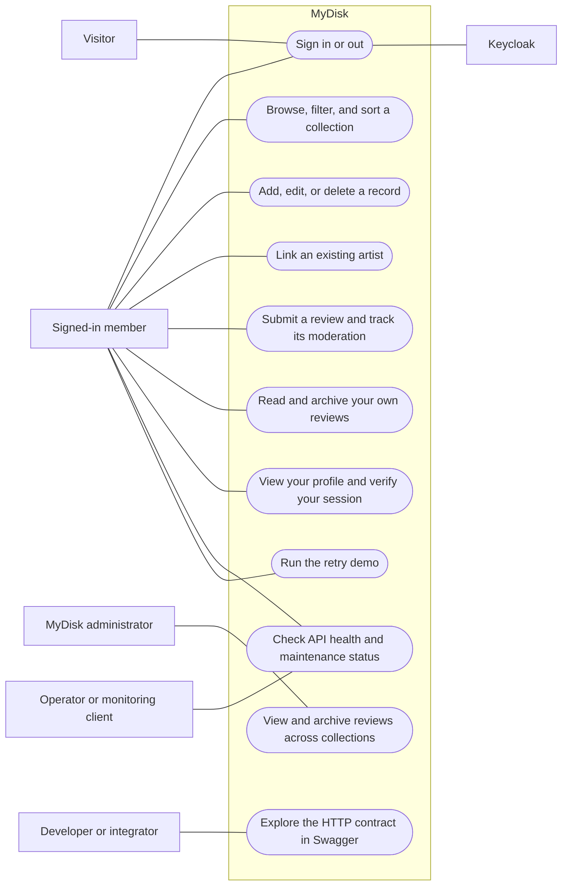
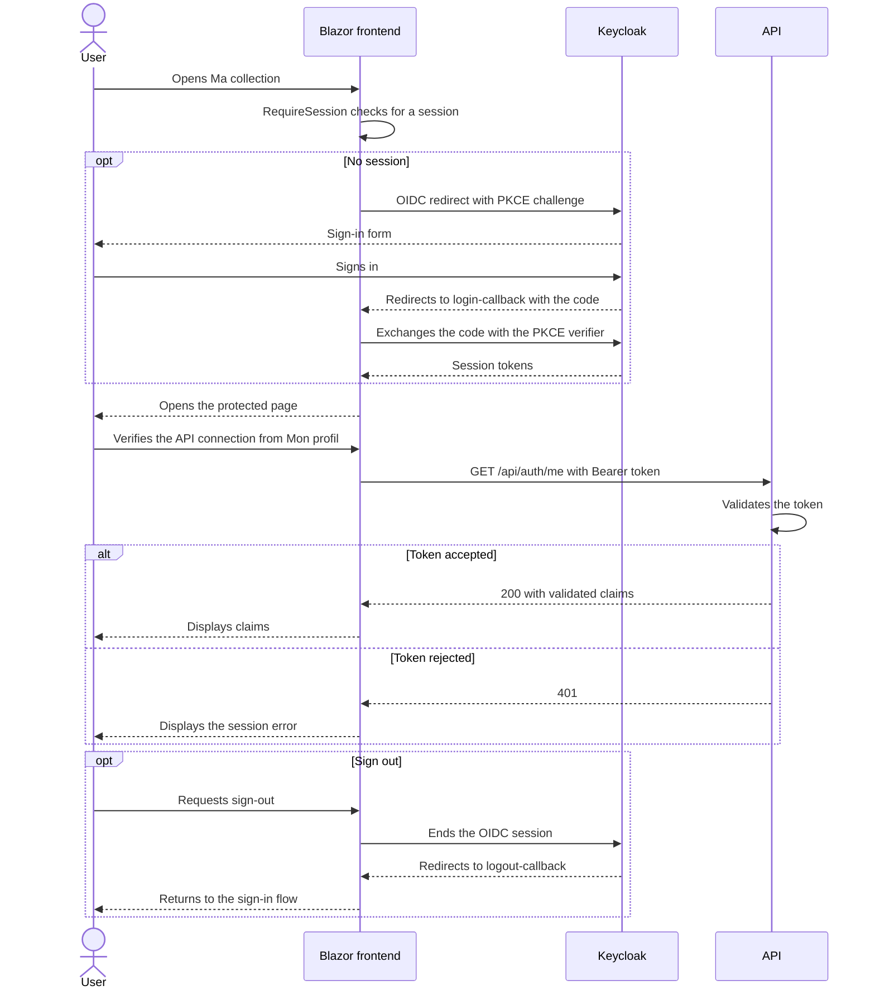
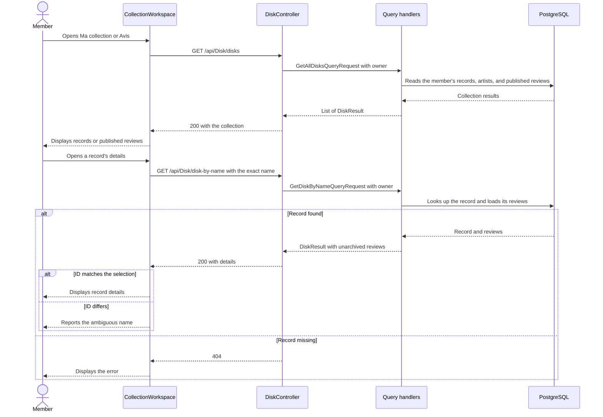
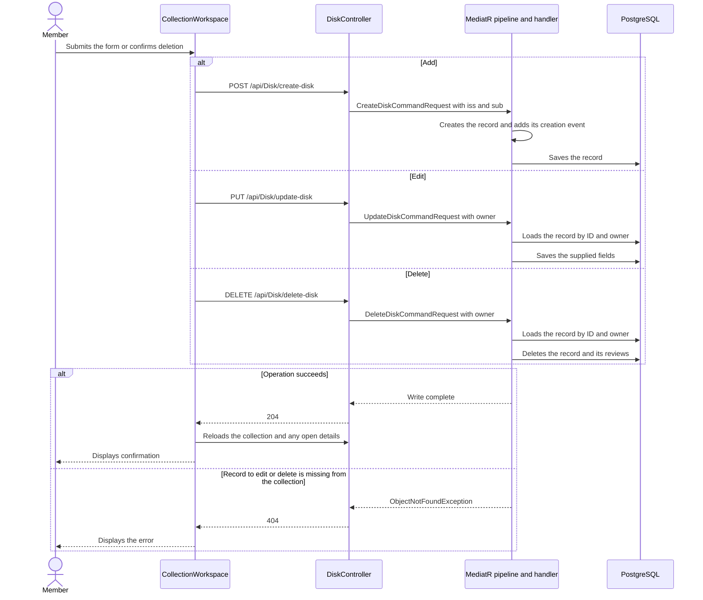
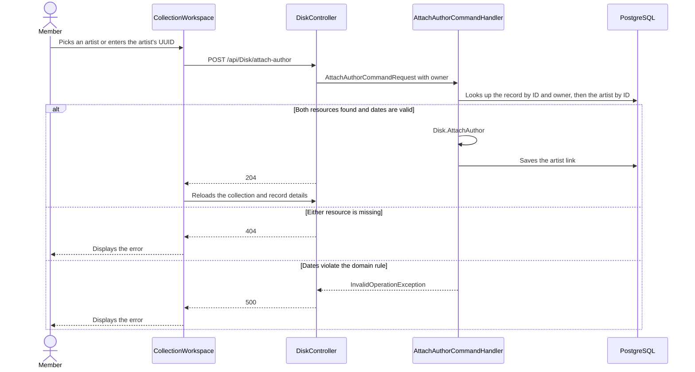
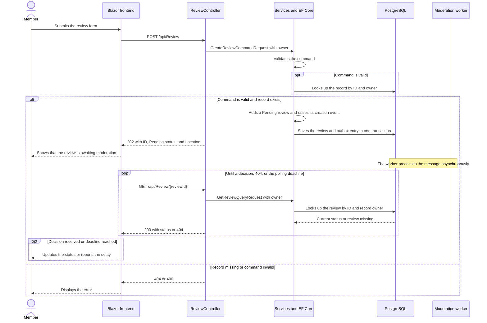
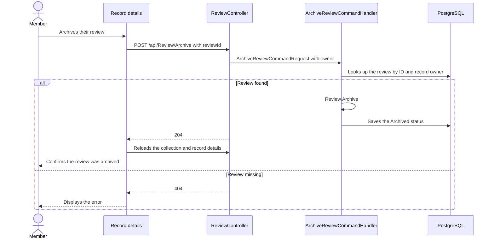
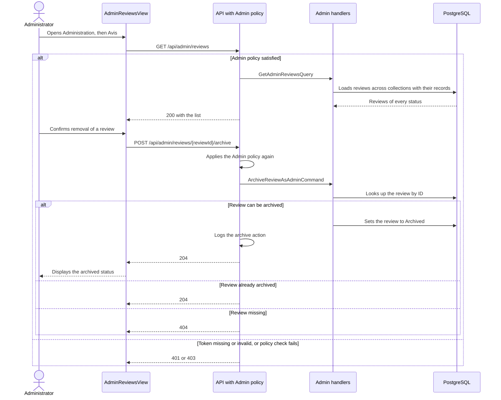
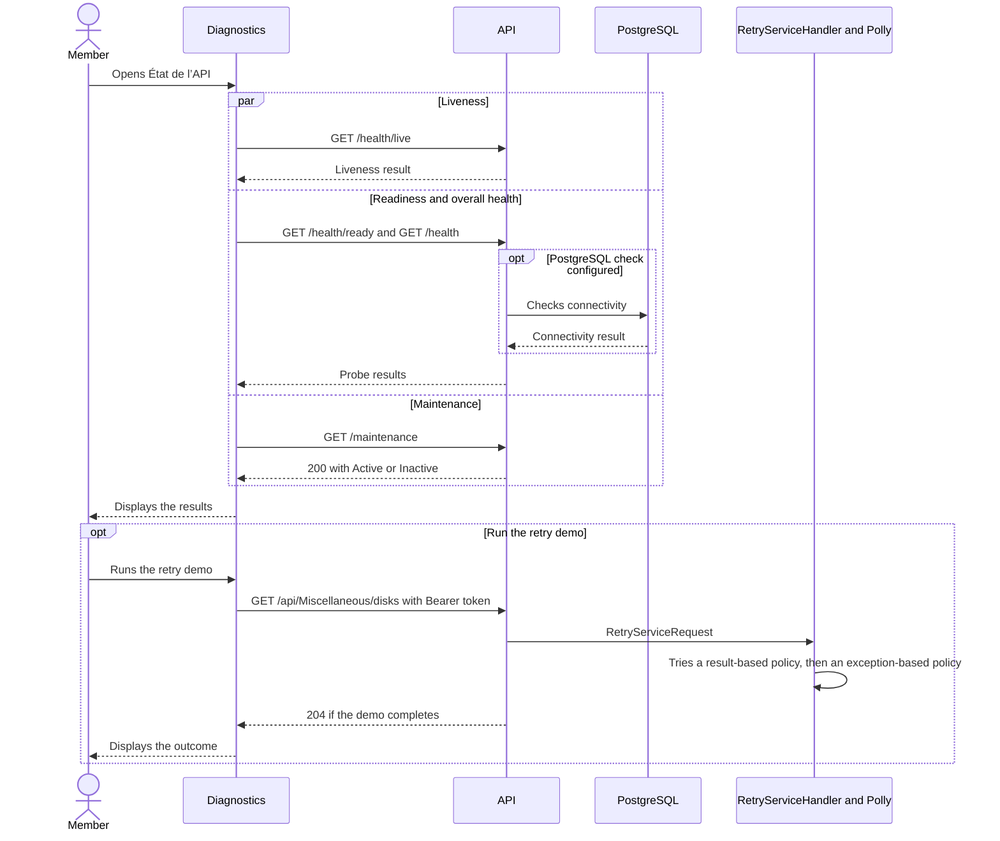

# MyDisk use cases

MyDisk lets each account manage its own record collection and reviews. The `admin` role gives access to a screen for managing reviews across collections. This guide maps actions in the frontend to their HTTP routes and the components that handle them. [Architecture](ARCHITECTURE.md) · [Class responsibilities](CLASSES.md) · [Worker and moderation](WORKER.md)

## Actors and use cases

| Actor | Actions |
| --- | --- |
| Visitor | Sign in through Keycloak. The HTTP health probes are also available without a session. |
| Member | Manage a collection, submit and archive reviews, check review status, verify a session, and check API health. |
| MyDisk administrator | Use member features and view or archive reviews across collections with the `admin` client role. |
| Operator or monitoring client | Check health and maintenance status. |
| Developer or integrator | Explore the HTTP contract in Swagger. |
| Keycloak | Authenticate accounts, issue tokens, and end sessions when users sign out. |

The API identifies the owner by the pair of `iss` and `sub` claims in the validated token. Personal collection operations filter by that owner for every account, including administrators. The API treats resources outside the signed-in account's collection as missing. Legacy records with no owner stay outside personal collections. [Owner identity](../apps/api/src/Api/Controllers/DiskOwnerClaims.cs) · [Collection isolation tests](../apps/api/src/Api.IntegrationTests/Controllers/PrivateCollectionFixture.cs)

## HTTP routes

| Action | Method and route | Access | Successful response |
| --- | --- | --- | --- |
| Verify the token sent to the API | `GET /api/auth/me` | Valid token | `200` with claims |
| List records and their published reviews | `GET /api/Disk/disks` | Owner | `200` with a list, which may be empty |
| Look up a record by exact name | `GET /api/Disk/disk-by-name?name=…` | Owner | `200` with record details |
| Add a record | `POST /api/Disk/create-disk` | Session with `iss` and `sub` | `204` |
| Edit a record | `PUT /api/Disk/update-disk` | Owner | `204` |
| Delete a record | `DELETE /api/Disk/delete-disk?diskId=…` | Owner | `204` |
| Link an artist | `POST /api/Disk/attach-author` | Owner | `204` |
| Submit a review | `POST /api/Review` | Record owner | `202` with the review ID, `Pending` status, and a `Location` header |
| Look up a review by ID | `GET /api/Review/{reviewId}` | Record owner | `200` with review details |
| Archive a review from the record details | `POST /api/Review/Archive` | Record owner | `204` |
| List reviews across collections | `GET /api/admin/reviews` | `admin` role | `200` with reviews of every status |
| Archive a review from the administration screen | `POST /api/admin/reviews/{reviewId}/archive` | `admin` role | `204` |
| Check liveness, readiness, or overall health | `GET /health/live`, `GET /health/ready`, `GET /health` | Public | `200` with `Healthy` when the probe succeeds |
| Read maintenance status | `GET /maintenance` | Public | `200` with `Active` or `Inactive` |
| Run the retry demo | `GET /api/Miscellaneous/disks` | Valid token | `204` when the demo completes |
| Explore the HTTP contract | `GET /swagger/index.html` | Public | `200` with Swagger UI |

Protected routes return `401` when authentication fails and `403` when the token is valid and lacks the claims required for the operation. The MVC exception filter maps FluentValidation and format errors to `400` and missing resources to `404`. The maintenance filter returns `503` for the MVC actions it blocks. [Controllers](../apps/api/src/Api/Controllers/) · [JWT validation and Admin policy](../apps/api/src/Api/KeycloakAuthentication.cs) · [MVC filters](../apps/api/src/Api/Filters/)

## Sign in, verify the session, and sign out

All application pages in the frontend go through `RequireSession`. The local public Keycloak client uses the OIDC Authorization Code flow with PKCE S256. Protected API calls use an access token whose signature, expiration, issuer, and audience the API validates. The **Mon profil** page displays the Blazor session claims and can separately verify the claims in the access token sent to the API. [Blazor routing](../apps/frontend/src/App.razor) · [Local realm](../apps/keycloak/k8s/overlays/local/mydisk-realm.json) · [Profile page](../apps/frontend/src/Pages/ProfilePage.razor)

## Browse the collection and open record details

The **Ma collection** page filters records in the browser by name or artist pseudonym and sorts by name or release date. The **Avis** page uses the same private collection and shows its published reviews. A record's detail view also shows pending and rejected reviews. Archived reviews are omitted from record details. The API looks up a record by exact name. If multiple records share a name and the returned ID differs from the user's selection, the frontend displays an ambiguity message. [Navigation and loading](../apps/frontend/src/Components/CollectionWorkspace.razor.cs) · [EF Core repository](../apps/api/src/Data/DiskRepository.cs) · [Record mapping](../apps/api/src/Services/Disks/MapperProfiles.cs)

## Add, edit, or delete a record

The Blazor form asks for a name of up to 30 characters and a release date. On creation, the server reads the owner from the token and raises a `NewDiskCreatedDomainEvent`. Its handler logs the record ID during the EF Core save. The update endpoint applies the supplied fields. Deletion requires confirmation in the frontend and cascades to the record's reviews. [Blazor editor](../apps/frontend/src/Components/DiskEditor.razor.cs) · [Record commands](../apps/api/src/Services/Disks/) · [Record-to-review relationship](../apps/api/src/Data.Configurations/Reviews/ReviewConfiguration.cs)

## Link an existing artist

In the record details, the member selects an artist from the loaded collection or enters the artist's UUID. The server loads the record owned by the account and the matching artist. When the record has a release date, `Disk.AttachAuthor` requires the artist's birth date to precede it. [Artist form](../apps/frontend/src/Components/DiskDetail.razor.cs) · [Handler](../apps/api/src/Services/Disks/AttachAuthorCommandHandler.cs) · [Domain rule](../apps/api/src/Domain/Disks/Disk.cs)

## Submit a review and track its status

The Blazor record details show the form from the record's release date. The form collects a title of up to 30 characters, the review text, and a rating from 0 to 5. The API saves the `Pending` review and its outbox message in the same transaction, then returns `202`. The frontend polls by review ID with increasing, jittered delays and checks a 60-second deadline between attempts. Polling stops when the review leaves `Pending` or the API returns `404`. Reopening the record details resumes tracking any pending reviews. [Blazor record details](../apps/frontend/src/Components/DiskDetail.razor) · [Controller](../apps/api/src/Api/Controllers/ReviewController.Post.cs) · [Frontend polling](../apps/frontend/src/Services/ReviewModerationWatcher.cs) · [Message publishing and consumption](WORKER.md)

## Archive a review as the owner

Archiving from the record details uses the same ownership check as a direct review lookup. It sets the review's status to `Archived`. On reload, the review disappears from the record details and the published reviews list. The owner can still retrieve it by ID, and it remains visible on the administration screen. [Archive handler](../apps/api/src/Services/Reviews/ArchiveReviewCommandHandler.cs) · [Query handler](../apps/api/src/Services/Reviews/GetReviewQueryHandler.cs) · [Record mapping](../apps/api/src/Services/Disks/MapperProfiles.cs)

## Administer reviews

The frontend shows **Administration → Avis** when the account's `mydisk_roles` claim contains `admin`. The controller enforces the `Admin` policy on the JWT and also requires `sub`. The list includes reviews of every status with their record names. When a review is archived for the first time, the controller logs the issuer, subject, and review ID after the write. Repeating the operation on an archived review also returns `204` without another review update. [Administration screen](../apps/frontend/src/Components/AdminReviewsView.razor) · [Controller](../apps/api/src/Api/Controllers/AdminReviewsController.cs) · [Handler](../apps/api/src/Services/Reviews/ArchiveReviewAsAdminCommand.cs)

## Health probes, maintenance, and retry demo

The **État de l’API** screen calls the three health probes and `/maintenance` in parallel. `/health/live` confirms that the HTTP process responds. `/health/ready` checks PostgreSQL when a connection is configured, and `/health` runs all registered checks. Setting `MaintenanceSettings:Global` blocks MVC actions covered by the maintenance filter. The probes, `/maintenance`, and the `/api/auth/me` minimal API route remain available under their usual access rules. [Probes and routes](../apps/api/src/Api/Program.cs) · [PostgreSQL health check registration](../apps/api/src/Api/DependencyInjection.cs) · [API status screen](../apps/frontend/src/Components/Diagnostics.razor.cs)

The demo uses `PollyRetryService` to run two scenarios driven by random values. `RetryServiceSettings` configures the retry count and delay. The worker guide covers the retry behavior of the moderation flow. [Demo scenarios](../apps/api/src/Services/Miscellaneous/RetryServiceHandler.cs) · [Polly implementation](../apps/api/src/RetryService/PollyRetryService.cs) · [Worker retries](WORKER.md)
