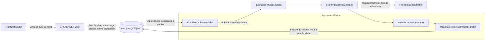
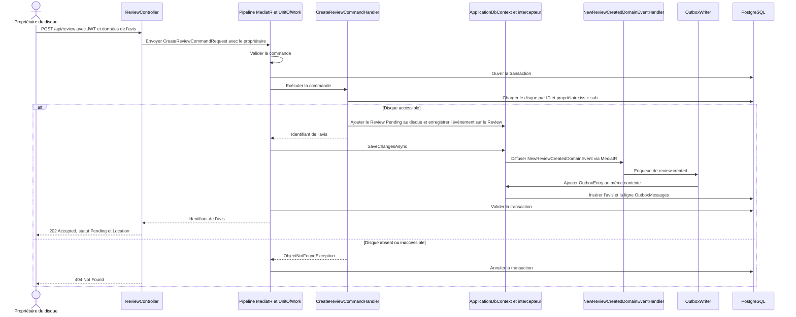
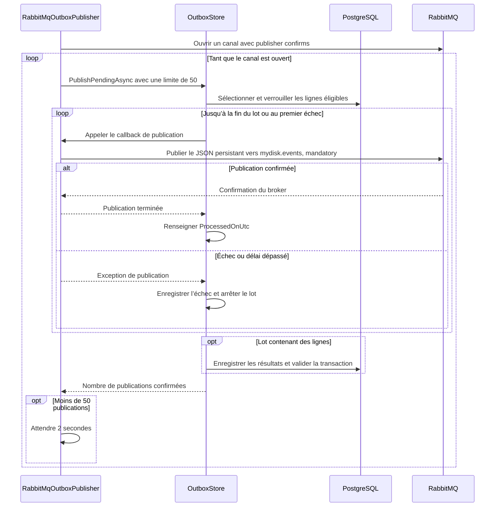
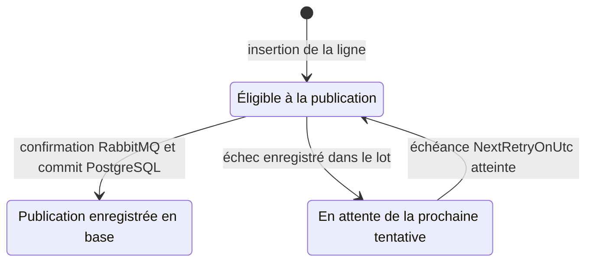
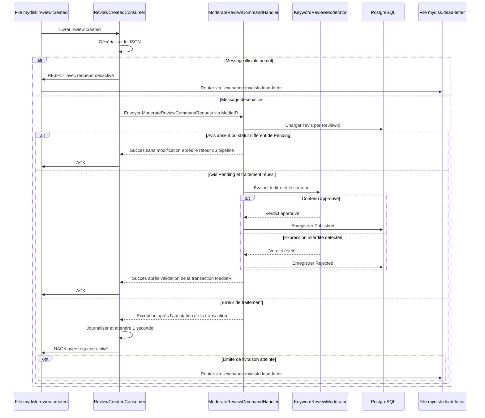
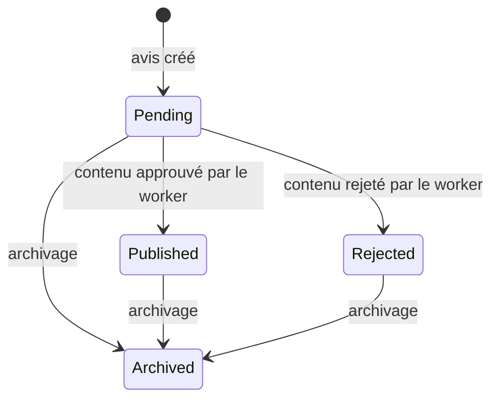
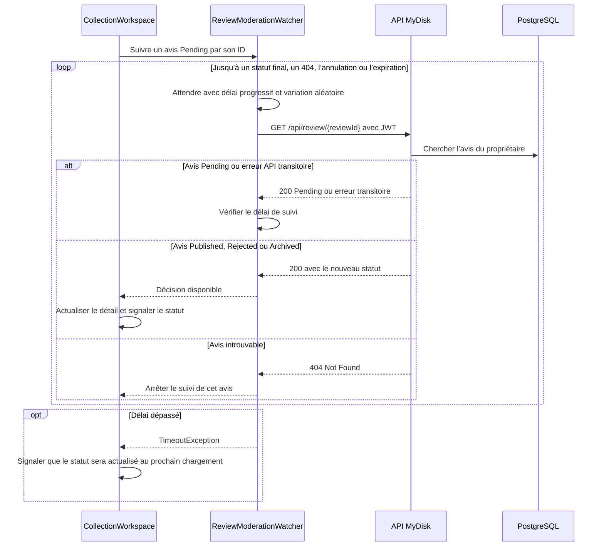

# Worker et modération des avis

Le worker .NET prend en charge la modération en arrière-plan. L’API enregistre l’avis au statut `Pending` et répond `202 Accepted` avec un identifiant et un en-tête `Location` vers la route de suivi. Le worker publie ensuite l’événement de création dans RabbitMQ, consomme ce message et applique la décision dans PostgreSQL. Le navigateur consulte l’API pour connaître le nouveau statut. Si le worker ou RabbitMQ est temporairement indisponible, l’avis et le message à publier restent en base.



## Classes du circuit asynchrone

| Classe ou contrat | Rôle |
|---|---|
| [`Worker/Program.cs`](../apps/api/src/Worker/Program.cs) | Démarre le Generic Host, raccorde les services applicatifs et charge `ReviewModeration` et `RabbitMq`. |
| [`Messaging.DependencyInjection`](../apps/api/src/Messaging/DependencyInjection.cs) et [`RabbitMqOptions`](../apps/api/src/Messaging/RabbitMqOptions.cs) | Valident la configuration du broker et enregistrent le publieur et le consommateur comme services hébergés. Chaque service ouvre sa propre connexion et son propre canal. |
| [`CreateReviewCommandHandler`](../apps/api/src/Services/Reviews/CreateReviewCommandHandler.cs) et [`NewReviewCreatedDomainEvent`](../apps/api/src/Domain/Reviews/NewReviewCreatedDomainEvent.cs) | Retrouvent le disque du propriétaire, y attachent un nouvel avis et signalent sa création. |
| [`EntitySaveChangesInterceptor`](../apps/api/src/Data/EntitySaveChangesInterceptor.cs) et [`MediatRDomainEventDispatcher`](../apps/api/src/Services/MediatRDomainEventDispatcher.cs) | Extraient les événements des entités suivies par EF Core et les diffusent en mémoire avant l’écriture SQL. |
| [`NewReviewCreatedDomainEventHandler`](../apps/api/src/Services/Reviews/NewReviewCreatedDomainEventHandler.cs) et [`ReviewCreatedMessage`](../apps/api/src/Services/Reviews/ReviewCreatedMessage.cs) | Convertissent l’événement de domaine en un message `review.created` contenant `ReviewId`, `DiskId` et `PublishedDate`. Cette date est initialisée à la création de l’avis. |
| [`IOutboxWriter`](../apps/api/src/Services/Messaging/IOutboxWriter.cs) et [`OutboxWriter`](../apps/api/src/Data/Messaging/OutboxWriter.cs) | Sérialisent le message en JSON et l’ajoutent au `ApplicationDbContext` courant. L’identifiant de corrélation reprend le `TraceId` W3C courant quand il existe, ou un GUID généré. |
| [`OutboxEntry`](../apps/api/src/Data.Configurations/Outbox/OutboxEntry.cs) et [`OutboxConfiguration`](../apps/api/src/Data.Configurations/Outbox/OutboxConfiguration.cs) | Définissent la ligne `OutboxMessages`, le contenu `jsonb`, le suivi des tentatives et l’index des lignes à traiter. |
| [`IOutboxStore`](../apps/api/src/Services/Messaging/IOutboxStore.cs), [`OutboxMessage`](../apps/api/src/Services/Messaging/OutboxMessage.cs) et [`OutboxStore`](../apps/api/src/Data/Messaging/OutboxStore.cs) | Lisent et verrouillent un lot éligible, le passent au publieur via un callback et enregistrent le résultat en base. |
| [`RabbitMqOutboxPublisher`](../apps/api/src/Messaging/RabbitMqOutboxPublisher.cs) | Interroge l’outbox, publie les messages persistants et attend la confirmation du broker pour chaque envoi. |
| [`RabbitMqConsumer<TMessage>`](../apps/api/src/Messaging/RabbitMqConsumer.cs) | Gère l’abonnement, la désérialisation, la portée DI de chaque livraison et les acquittements manuels. |
| [`ReviewCreatedConsumer`](../apps/api/src/Messaging/ReviewCreatedConsumer.cs) et [`ModerateReviewCommandRequest`](../apps/api/src/Services/Reviews/ModerateReviewCommandRequest.cs) | Écoutent `mydisk.review.created` et transmettent à MediatR une commande portant l’identifiant de l’avis. |
| [`ModerateReviewCommandHandler`](../apps/api/src/Services/Reviews/ModerateReviewCommandHandler.cs) et [`ReviewRepository`](../apps/api/src/Data/ReviewRepository.cs) | Relisent l’avis en base, appliquent la décision uniquement si son statut est `Pending` et enregistrent le nouveau statut. |
| [`IReviewModerator`](../apps/api/src/Services/Reviews/Moderation/IReviewModerator.cs) et [`KeywordReviewModerator`](../apps/api/src/Services/Reviews/Moderation/KeywordReviewModerator.cs) | Découplent la décision du transport. L’implémentation normalise la casse, les accents et les séparateurs du titre et du contenu, puis cherche des expressions interdites définies dans le code. |
| [`ReviewModerationResult`](../apps/api/src/Services/Reviews/Moderation/ReviewModerationResult.cs) et [`ReviewModerationSettings`](../apps/api/src/Services/Reviews/Moderation/ReviewModerationSettings.cs) | Représentent le verdict et son motif éventuel, et permettent de simuler la latence de la décision. Le motif est consigné dans les logs du worker. |

## Création de l’avis et écriture de l’outbox

L’outbox transactionnelle désigne la table PostgreSQL qui conserve les messages à envoyer. L’avis et son message sont enregistrés dans la même transaction via le `ApplicationDbContext` partagé. Un échec de l’écriture annule les deux. L’API et le worker ont ainsi chacun leur propre étape, et l’API peut accepter un avis pendant une interruption du broker.



## Publication dans RabbitMQ

Le publieur traite jusqu’à 50 lignes par lot. Il attend 2 secondes si le lot a publié moins de 50 messages. La sélection porte sur les lignes dont `ProcessedOnUtc` est vide et dont `NextRetryOnUtc` est vide ou arrivé à échéance. `FOR UPDATE SKIP LOCKED` permet à plusieurs publieurs de traiter des lots distincts en ignorant les lignes verrouillées. Chaque message utilise sa clé de routage `review.created`, porte son identifiant d’outbox comme `MessageId` et dispose d’un délai de publication de 15 secondes. [Sélection SQL](../apps/api/src/Data/Messaging/OutboxStore.cs) · [Publication RabbitMQ](../apps/api/src/Messaging/RabbitMqOutboxPublisher.cs)



La première erreur d’un lot interrompt son traitement. Les lignes précédentes confirmées sont marquées comme traitées, la ligne en échec reçoit une nouvelle échéance, et les lignes suivantes restent éligibles. L’intervalle entre tentatives commence à 5 secondes puis double jusqu’à 5 minutes. `RetryCount` et `LastError` renseignent l’échec de publication. Le code conserve les lignes traitées et continue de réessayer les échecs de publication sans seuil terminal. [État de l’outbox](../apps/api/src/Data.Configurations/Outbox/OutboxEntry.cs)



## Consommation, décision et relivraison

L’exchange `mydisk.events` route `review.created` vers la file quorum durable `mydisk.review.created`. Le consommateur limite le nombre de livraisons non acquittées à 10 avec le prefetch. Il confirme chaque livraison par `ACK` après la fin de la commande MediatR, qui inclut la validation de la transaction. La topologie est importée au démarrage du `StatefulSet` RabbitMQ. [Définitions RabbitMQ](../apps/messaging/k8s/base/definitions.json) · [Démarrage du broker](../apps/messaging/k8s/base/statefulset.yml)



| Situation | Effet observable |
|---|---|
| Connexion ou canal RabbitMQ interrompu | Le publieur et le consommateur retentent la connexion après 5 secondes. |
| Confirmation RabbitMQ reçue avant un arrêt ou un échec de validation de l’outbox | Le message peut être republié si `ProcessedOnUtc` n’a pas été enregistré. Ce champ indique la publication, indépendamment du résultat de modération. |
| Livraison répétée après une modération déjà enregistrée | Le handler constate le statut différent de `Pending` et le consommateur acquitte la livraison sans modifier l’avis. Ce contrôle couvre les rediffusions successives. |
| Archivage pendant une modération | Le worker vérifie le statut lors de la lecture. Si l’archivage est validé ensuite, une écriture concurrente du statut par le worker peut l’écraser. Le mapping EF Core du statut ne définit aucun jeton de concurrence. |
| Avis supprimé avec son disque avant le traitement | Le handler constate son absence, termine normalement et le consommateur acquitte la livraison. |
| JSON illisible ou message nul | Le consommateur rejette la livraison et la politique RabbitMQ la dirige vers `mydisk.dead-letter`. |
| Échecs répétés de modération | La file quorum applique une politique `delivery-limit` de `5`. Au terme des relivraisons autorisées, RabbitMQ déplace le message vers `mydisk.dead-letter`. L’avis peut rester `Pending` et aucun consommateur de cette file n’est enregistré. |

[Lecture et écriture du verdict](../apps/api/src/Services/Reviews/ModerateReviewCommandHandler.cs) · [Dépôt des avis](../apps/api/src/Data/ReviewRepository.cs) · [Mapping EF Core](../apps/api/src/Data.Configurations/Reviews/ReviewConfiguration.cs)

## États d’un avis

Le statut `Rejected` est une décision de modération réussie. Les erreurs techniques de traitement suivent le circuit de relivraison RabbitMQ. L’archivage relève d’une action explicite du propriétaire du disque ou d’un administrateur. [Agrégat `Review`](../apps/api/src/Domain/Reviews/Review.cs) · [Archivage propriétaire](../apps/api/src/Services/Reviews/ArchiveReviewCommandHandler.cs) · [Archivage administrateur](../apps/api/src/Services/Reviews/ArchiveReviewAsAdminCommand.cs)



## Suivi de l’avis dans le frontend

`CollectionWorkspace` démarre le suivi à l’envoi d’un avis ou à l’ouverture d’un disque contenant un avis `Pending`. `ReviewModerationWatcher` appelle `GET /api/review/{reviewId}`. L’API limite la lecture au propriétaire du disque. L’intervalle démarre à 1 seconde, double jusqu’à 8 secondes et varie légèrement à chaque essai. Le temps de suivi visé est de 60 secondes. L’interface signale un statut final ou invite à consulter le disque plus tard si l’attente dépasse ce délai. [Orchestration Blazor](../apps/frontend/src/Components/CollectionWorkspace.razor.cs) · [Scrutation du statut](../apps/frontend/src/Services/ReviewModerationWatcher.cs) · [Lecture côté API](../apps/api/src/Services/Reviews/GetReviewQueryHandler.cs)



## Exécution et diagnostic en local

Sur k3d, `make dev-up` déploie RabbitMQ et un réplica du worker dans la pile locale. Le worker démarre après le job de migrations et utilise le même compte PostgreSQL applicatif que l’API. L’overlay local injecte les identifiants RabbitMQ via `rabbitmq-credentials`, configure `RabbitMq__HostName=mydisk-messaging` et ajoute 3 secondes de latence simulée avec `ReviewModeration__SimulatedLatency`. La configuration `RabbitMq` demande un hôte, un utilisateur et un mot de passe. Les autres valeurs par défaut sont le port `5672`, le vhost `/` et l’exchange `mydisk.events`. [Déploiement worker](../apps/api/k8s/base/worker-deployment.yml) · [Overlay local](../apps/api/k8s/overlays/local/kustomization.yml) · [Makefile](../Makefile)

```sh
make k8s-status
make k8s-logs-worker
```

Pour suivre un avis, partir de l’identifiant renvoyé dans le `202` et chercher `ReviewId` dans les logs de modération. Si la publication échoue, les logs du publieur indiquent le `MessageId`, qui correspond à l’identifiant de la ligne d’outbox. Examiner `NextRetryOnUtc`, `RetryCount` et `LastError` permet de situer l’échec avant publication.

L’overlay AKS actuel retire le `Deployment` du worker et omet RabbitMQ. L’API peut toujours créer l’avis et sa ligne d’outbox. Les avis restent `Pending` jusqu’à une action d’archivage ou au traitement par un worker connecté à cet environnement. [Overlay API cloud](../apps/api/k8s/overlays/cloud/kustomization.yml) · [Composition cloud](../deploy/k8s/cloud/kustomization.yml)
