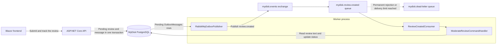
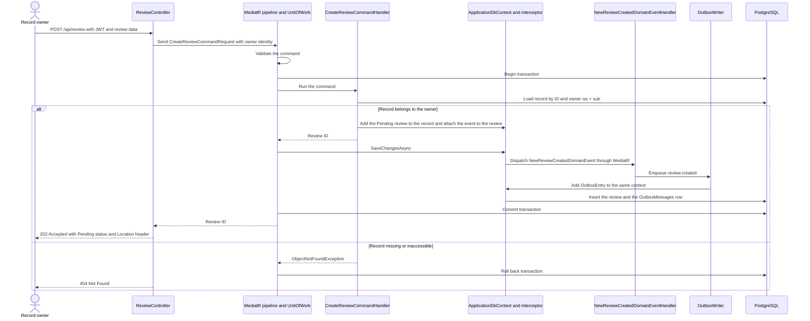
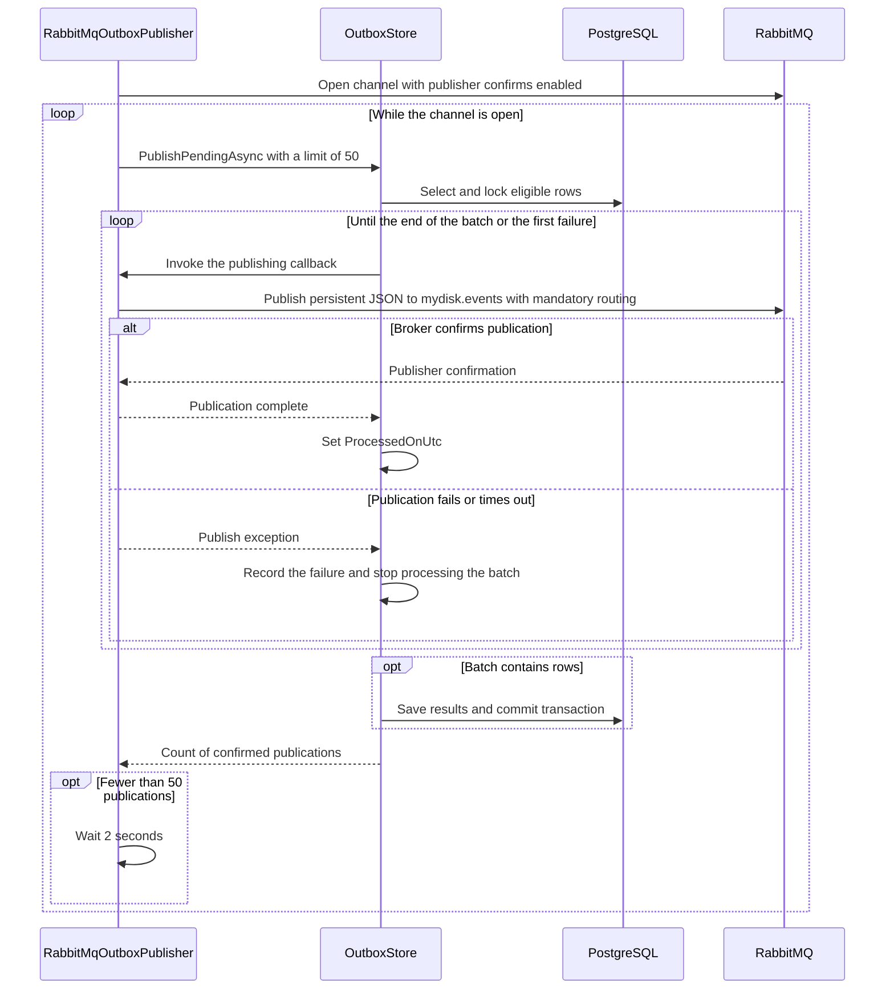
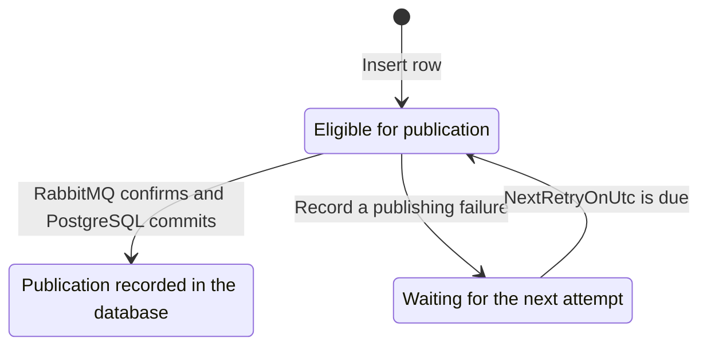
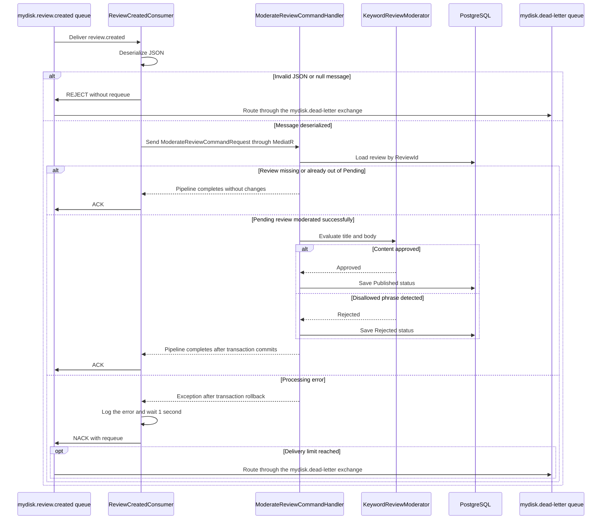
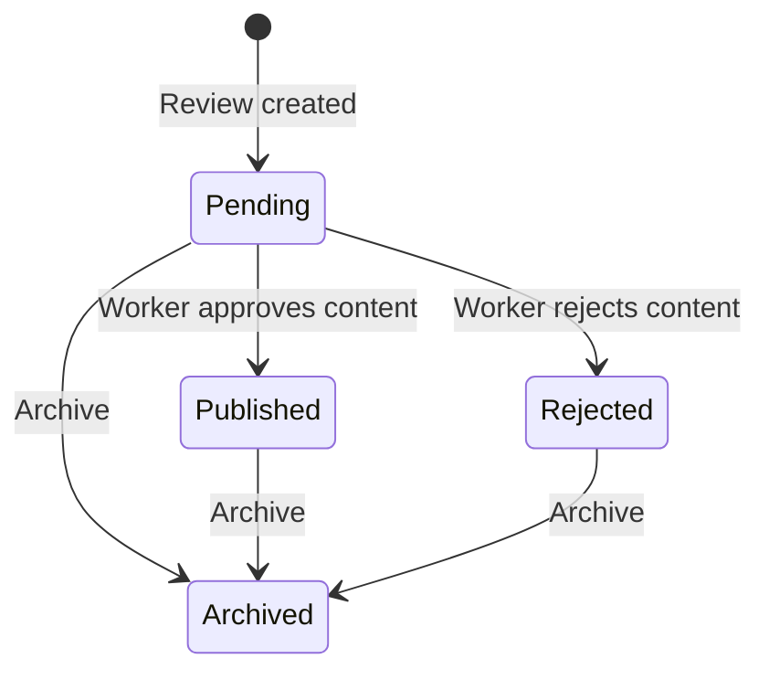
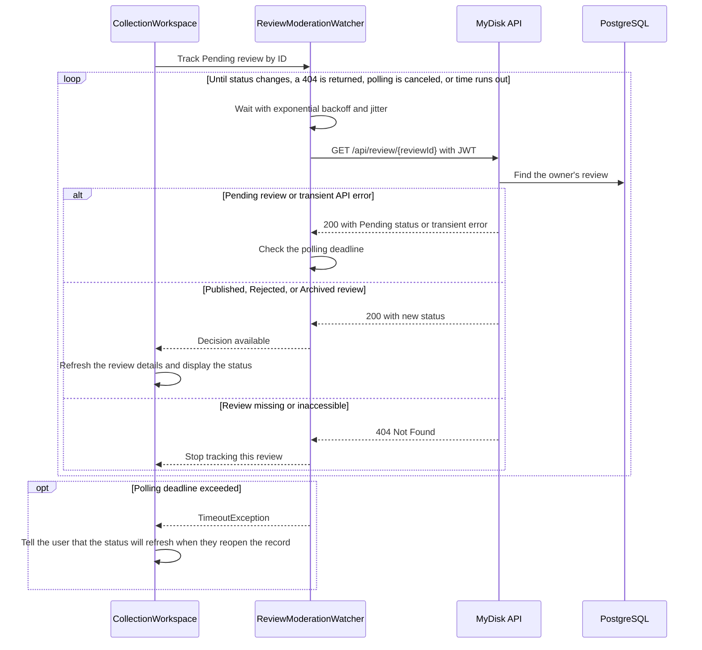

# Worker and review moderation

The .NET worker moderates reviews in the background. The API records a review as `Pending` and returns `202 Accepted` with the review ID and a `Location` header pointing to the status endpoint. The worker publishes the creation event to RabbitMQ, consumes the message, and saves the moderation decision in PostgreSQL. The browser polls the API for the new status. If the worker or RabbitMQ is temporarily unavailable, the database retains the review and the message awaiting publication.



## Classes in the asynchronous flow

| Class or contract | Responsibility |
|---|---|
| [`Worker/Program.cs`](../apps/api/src/Worker/Program.cs) | Starts the .NET Generic Host, registers application services, and loads the `ReviewModeration` and `RabbitMq` settings. |
| [`Messaging.DependencyInjection`](../apps/api/src/Messaging/DependencyInjection.cs) and [`RabbitMqOptions`](../apps/api/src/Messaging/RabbitMqOptions.cs) | Validate the broker settings and register the publisher and consumer as hosted services. Each service opens its own connection and channel. |
| [`CreateReviewCommandHandler`](../apps/api/src/Services/Reviews/CreateReviewCommandHandler.cs) and [`NewReviewCreatedDomainEvent`](../apps/api/src/Domain/Reviews/NewReviewCreatedDomainEvent.cs) | The handler loads the owner's record, adds a review to it, and raises the review creation event. |
| [`EntitySaveChangesInterceptor`](../apps/api/src/Data/EntitySaveChangesInterceptor.cs) and [`MediatRDomainEventDispatcher`](../apps/api/src/Services/MediatRDomainEventDispatcher.cs) | Collect events from entities tracked by EF Core and dispatch them in-process before EF Core writes to PostgreSQL. |
| [`NewReviewCreatedDomainEventHandler`](../apps/api/src/Services/Reviews/NewReviewCreatedDomainEventHandler.cs) and [`ReviewCreatedMessage`](../apps/api/src/Services/Reviews/ReviewCreatedMessage.cs) | Turn the domain event into a `review.created` message with `ReviewId`, `DiskId`, and `PublishedDate`. The review's constructor sets that date when the review is created. |
| [`IOutboxWriter`](../apps/api/src/Services/Messaging/IOutboxWriter.cs) and [`OutboxWriter`](../apps/api/src/Data/Messaging/OutboxWriter.cs) | Serialize the message to JSON and add it to the current `ApplicationDbContext`. The correlation ID uses the current W3C `TraceId` when available and a generated GUID otherwise. |
| [`OutboxEntry`](../apps/api/src/Data.Configurations/Outbox/OutboxEntry.cs) and [`OutboxConfiguration`](../apps/api/src/Data.Configurations/Outbox/OutboxConfiguration.cs) | Define an `OutboxMessages` row, its `jsonb` payload, retry metadata, and the index for rows awaiting publication. |
| [`IOutboxStore`](../apps/api/src/Services/Messaging/IOutboxStore.cs), [`OutboxMessage`](../apps/api/src/Services/Messaging/OutboxMessage.cs), and [`OutboxStore`](../apps/api/src/Data/Messaging/OutboxStore.cs) | Select and lock an eligible batch, invoke the publisher through a callback, and record the outcome in the database. |
| [`RabbitMqOutboxPublisher`](../apps/api/src/Messaging/RabbitMqOutboxPublisher.cs) | Polls the outbox, publishes persistent messages, and waits for confirmation from the broker after each send. |
| [`RabbitMqConsumer<TMessage>`](../apps/api/src/Messaging/RabbitMqConsumer.cs) | Manages the subscription, JSON deserialization, the dependency injection scope for each delivery, and manual acknowledgments. |
| [`ReviewCreatedConsumer`](../apps/api/src/Messaging/ReviewCreatedConsumer.cs) and [`ModerateReviewCommandRequest`](../apps/api/src/Services/Reviews/ModerateReviewCommandRequest.cs) | Consume messages from `mydisk.review.created` and send MediatR a moderation command containing the review ID. |
| [`ModerateReviewCommandHandler`](../apps/api/src/Services/Reviews/ModerateReviewCommandHandler.cs) and [`ReviewRepository`](../apps/api/src/Data/ReviewRepository.cs) | Load the review from the database, apply the decision only if its status is `Pending`, and save the new status. |
| [`IReviewModerator`](../apps/api/src/Services/Reviews/Moderation/IReviewModerator.cs) and [`KeywordReviewModerator`](../apps/api/src/Services/Reviews/Moderation/KeywordReviewModerator.cs) | Keep the moderation decision independent of message transport. The implementation normalizes case, accents, and separators in the title and body, then checks for disallowed phrases defined in code. |
| [`ReviewModerationResult`](../apps/api/src/Services/Reviews/Moderation/ReviewModerationResult.cs) and [`ReviewModerationSettings`](../apps/api/src/Services/Reviews/Moderation/ReviewModerationSettings.cs) | Represent the verdict with an optional reason and allow a simulated moderation delay. The worker logs the reason. |

## Creating a review and writing to the outbox

The transactional outbox is the PostgreSQL table that holds messages awaiting publication. The API writes the review and its message in one transaction through a shared `ApplicationDbContext`. If the write fails, the transaction rolls back both changes. The API can therefore accept a review during a broker outage.



## Publishing to RabbitMQ

The publisher processes up to 50 rows per batch and waits 2 seconds after a batch that published fewer than 50 messages. It selects rows whose `ProcessedOnUtc` is unset and whose `NextRetryOnUtc` is unset or due. `FOR UPDATE SKIP LOCKED` allows multiple publishers to process separate batches by skipping locked rows. Each `review.created` message uses its event type as the routing key and its outbox entry ID as the `MessageId`. Each publish attempt has a 15-second timeout. [Outbox SQL query](../apps/api/src/Data/Messaging/OutboxStore.cs) · [RabbitMQ publisher](../apps/api/src/Messaging/RabbitMqOutboxPublisher.cs)



The first error stops the batch. The store marks previously confirmed rows as processed, schedules a retry for the failed row, and leaves later rows eligible. The delay between attempts starts at 5 seconds and doubles up to 5 minutes. `RetryCount` and `LastError` record the publication failure. The code retains processed rows and retries failed publications indefinitely. [Outbox state](../apps/api/src/Data.Configurations/Outbox/OutboxEntry.cs)



## Consumption, moderation, and redelivery

The `mydisk.events` exchange routes `review.created` to the durable quorum queue `mydisk.review.created`. The consumer uses a prefetch limit of 10 unacknowledged deliveries. It sends an `ACK` once the MediatR command completes, including the database commit. The RabbitMQ `StatefulSet` imports the messaging topology at startup. [RabbitMQ definitions](../apps/messaging/k8s/base/definitions.json) · [Broker startup](../apps/messaging/k8s/base/statefulset.yml)



| Situation | Observable result |
|---|---|
| RabbitMQ connection or channel closes | The publisher and consumer try to reconnect after 5 seconds. |
| RabbitMQ confirms publication before a shutdown or an outbox commit failure | The publisher can send the message again if it could not persist `ProcessedOnUtc`. This timestamp tracks publication independently of the moderation outcome. |
| Message redelivered after the moderation result was saved | The handler sees that the review has left `Pending` and the consumer acknowledges the delivery without changing the review. This check handles sequential redeliveries. |
| Review archived while moderation is running | The worker checks the status when it reads the review. If the archive transaction commits after that read, a concurrent write by the worker can overwrite the archived status. The EF Core mapping defines no concurrency token for the review. |
| Review deleted with its record before processing | The handler finds no review and completes successfully. The consumer acknowledges the delivery. |
| Invalid JSON or null message | The consumer rejects the delivery, and the RabbitMQ policy routes it to `mydisk.dead-letter`. |
| Repeated moderation errors | The quorum queue uses a `delivery-limit` of `5`. When the allowed redeliveries are exhausted, RabbitMQ moves the message to `mydisk.dead-letter`. The review can remain `Pending`, and the worker has no consumer registered for that queue. |

[Decision handling](../apps/api/src/Services/Reviews/ModerateReviewCommandHandler.cs) · [Review repository](../apps/api/src/Data/ReviewRepository.cs) · [EF Core mapping](../apps/api/src/Data.Configurations/Reviews/ReviewConfiguration.cs)

## Review states

`Rejected` is a completed moderation decision. Processing errors follow the RabbitMQ redelivery path. The record owner or an administrator can archive a review. [`Review` aggregate](../apps/api/src/Domain/Reviews/Review.cs) · [Owner archive handler](../apps/api/src/Services/Reviews/ArchiveReviewCommandHandler.cs) · [Administrator archive handler](../apps/api/src/Services/Reviews/ArchiveReviewAsAdminCommand.cs)



## Tracking a review in the frontend

`CollectionWorkspace` starts tracking when the user submits a review or opens a record with a `Pending` review. `ReviewModerationWatcher` polls `GET /api/review/{reviewId}`. The endpoint is restricted to the record owner. The polling interval starts at 1 second, doubles up to 8 seconds, and includes jitter on each attempt. The target tracking window is 60 seconds. The interface reports the final status, or prompts the user to check the record again later if polling times out. [Blazor workspace](../apps/frontend/src/Components/CollectionWorkspace.razor.cs) · [Status polling](../apps/frontend/src/Services/ReviewModerationWatcher.cs) · [API query handler](../apps/api/src/Services/Reviews/GetReviewQueryHandler.cs)



## Running and troubleshooting locally

On k3d, `make dev-up` deploys RabbitMQ and one worker replica. The worker starts after the migration job completes and uses the same PostgreSQL application role as the API. The local overlay loads RabbitMQ credentials from `rabbitmq-credentials`, sets `RabbitMq__HostName=mydisk-messaging`, and adds a 3-second simulated moderation delay with `ReviewModeration__SimulatedLatency`. The `RabbitMq` settings require a hostname, username, and password. The default port is `5672`, the default virtual host is `/`, and the default exchange is `mydisk.events`. [Worker deployment](../apps/api/k8s/base/worker-deployment.yml) · [Local overlay](../apps/api/k8s/overlays/local/kustomization.yml) · [Makefile](../Makefile)

```sh
make k8s-status
make k8s-logs-worker
```

To track a review, look up the ID returned in the `202` response as `ReviewId` in the moderation logs. If publication fails, the publisher logs its `MessageId`, which corresponds to the outbox row ID. The row's `NextRetryOnUtc`, `RetryCount`, and `LastError` show where publication stalled.

The current AKS overlay removes the worker `Deployment` and omits RabbitMQ. The API can still create the review and its outbox row. New reviews remain `Pending` until someone archives them or a worker connected to that environment processes them. [Cloud API overlay](../apps/api/k8s/overlays/cloud/kustomization.yml) · [Cloud deployment resources](../deploy/k8s/cloud/kustomization.yml)
